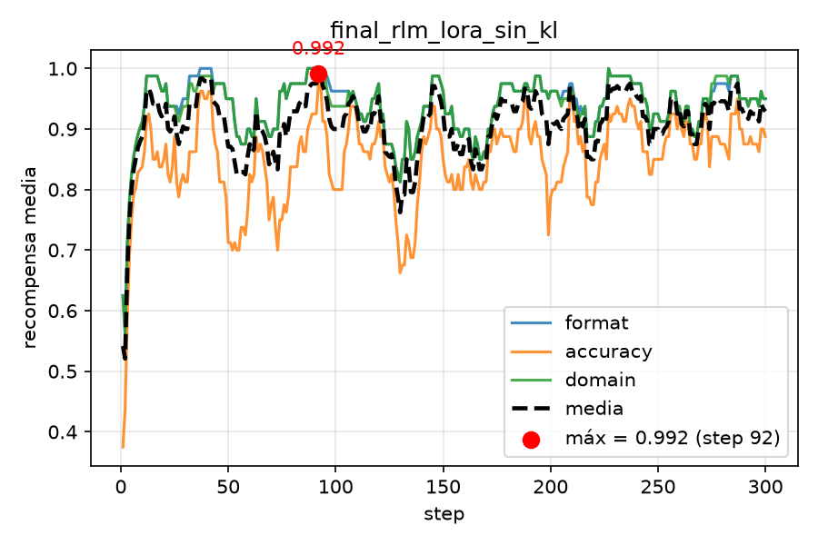
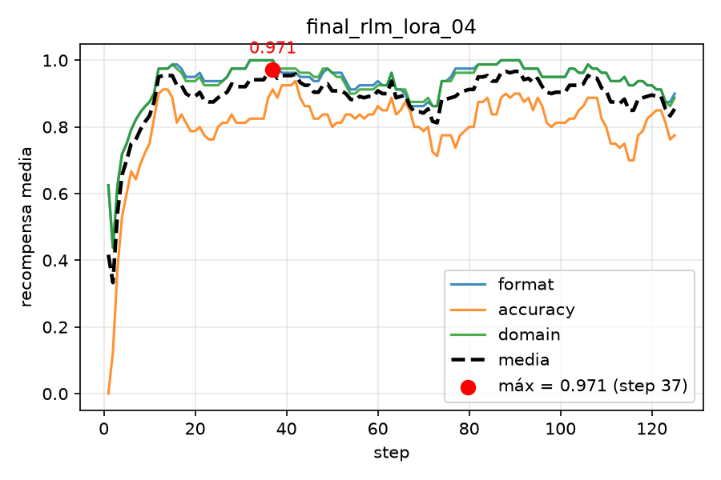
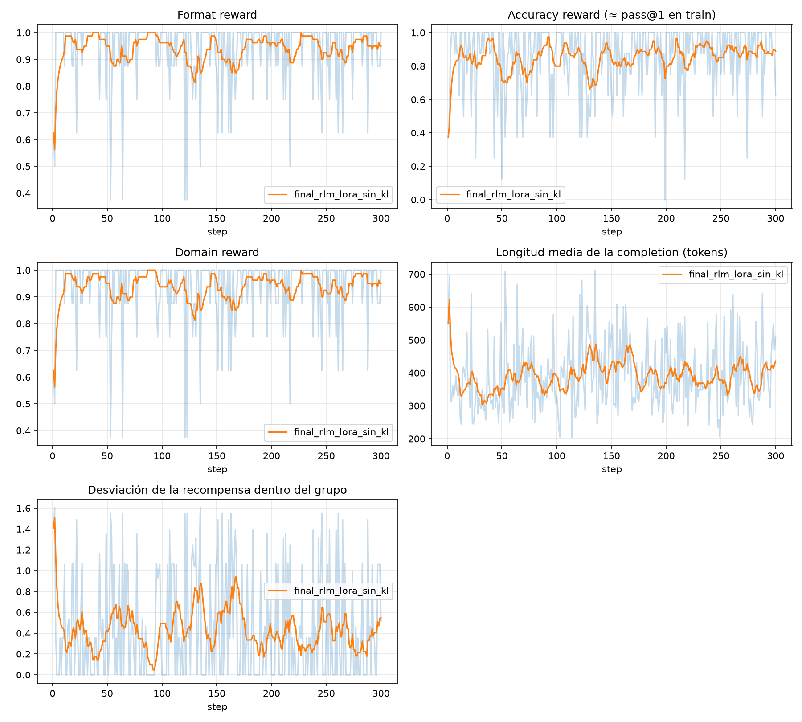
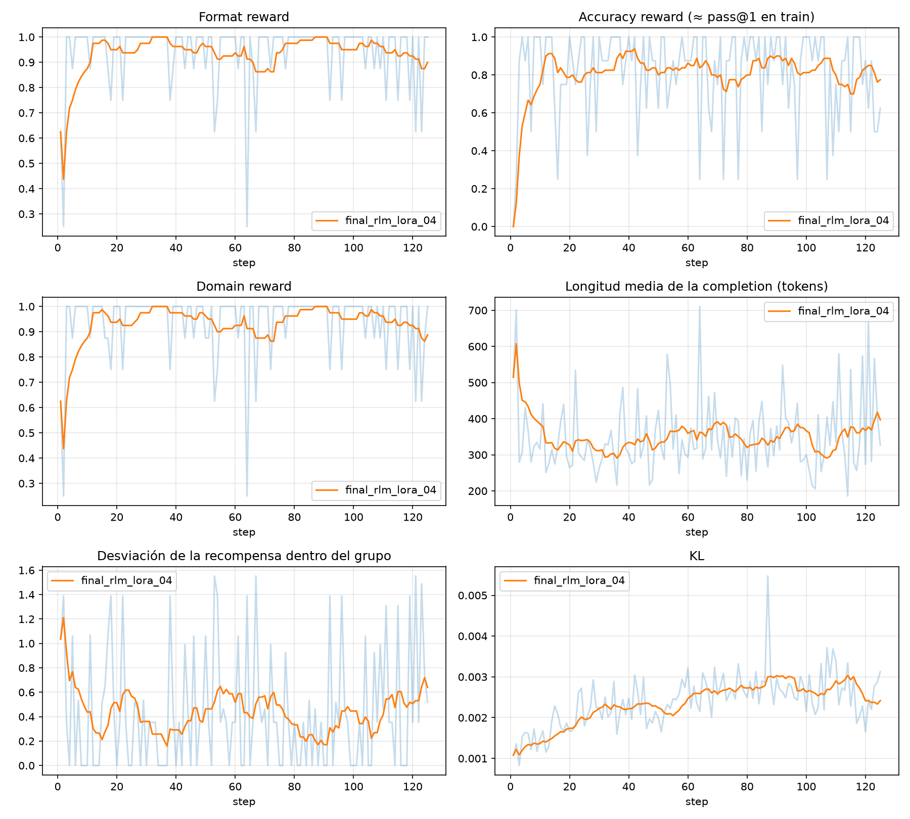
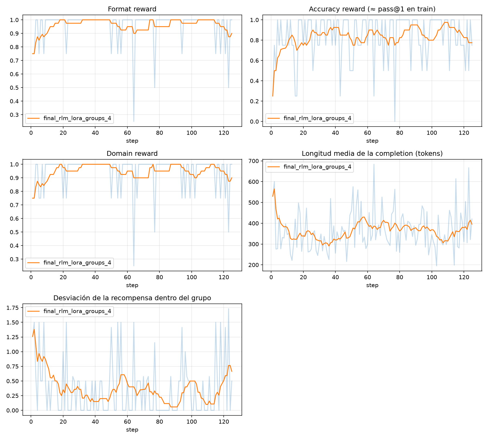

# EXPERIMENTS.md — cuaderno de experimentos

Copiad esta plantilla a la raíz de vuestro repositorio como `EXPERIMENTS.md` y añadid una
entrada cada vez que lancéis algo o toméis una decisión. Con fecha. No lo escribáis al final
de memoria: dentro de un mes no recordaréis por qué bajasteis la tasa de aprendizaje.

Una entrada honesta que diga "probamos X, no funcionó, creemos que por Y" vale más que diez
que digan "todo bien". Esto es lo primero que leo cuando corrijo interpretación.

---

## Formato de cada entrada

```
### AAAA-MM-DD · Fase N · Título corto

**Qué queríamos saber.** La pregunta o la hipótesis.
**Qué hicimos.** Comando exacto, modelo, datos, hiperparámetros que cambian respecto a la
entrada anterior.
**Qué pasó.** Números, curva (enlace a reports/), ejemplos.
**Qué concluimos.** Y qué hacemos a continuación.
```

---

## Ejemplo

### 2026-10-02 · Fase 1 · Primer GRPO sobre nuestro dataset

**Qué queríamos saber.** Si el modelo aprende el formato con nuestro prompt de sistema antes
de preocuparnos por la exactitud.

**Qué hicimos.** `uv run python -m rlm.train_grpo --data rlm/data/train.jsonl --steps 100
--num-generations 8 --max-completion-length 512` partiendo del adaptador de SFT. Sin KL.

**Qué pasó.** La recompensa de formato pasa de 0.31 a 0.97 en 40 pasos. La de exactitud sube
de 0.18 a 0.26 y se estanca. La longitud media baja de 480 a 210 tokens: el modelo aprende a
cerrar la etiqueta antes de quedarse sin presupuesto. Curva en `reports/grpo_run01.png`.

**Qué concluimos.** El formato está resuelto. La exactitud se estanca porque el 40 % de los
problemas del dataset tienen respuestas con unidades y el verificador numérico las ignora:
"120 litros" y "120" cuentan igual, pero "0.12 m³" cuenta como fallo. Siguiente paso:
normalizar unidades en el verificador y repetir.

---

## Entradas

### 2026-09-28 · Fase 1 · Generación de problemas
**Qué queríamos saber.** Si los valores de dosis, concentraciones y volúmenes del generador
tenían que salir de datos reales (p.ej. fichas técnicas de CIMA) o bastaba con rangos inventados.

**Qué hicimos.** Valoramos extraer posologías y presentaciones reales de CIMA. Lo descartamos 
para la fase 1: los datos de posología y dilución están en texto libre, dependen de la indicación,
la edad y la vía, y extraerlos exigiría que alguien del equipo leyese cada ficha y sacase los 
números a mano. En su lugar, muestreamos de listas de valores redondos (p.ej. dosis 5, 10, 25 mg;
viales 100mg/5mL) y descartamos los problemas cuya respuesta cae fuera de un rango plausible 
(`BOUNDS` en `generate_problems.py`).

El generador utiliza la plantilla de `generate_problems.py` (estrategia 1 de `datasets.md`): 
un sorteo de parámetros, una implementación de referencia (`solve`) que es a la vez el verificador, 
y varias plantillas de enunciado. Toda la aritmética se hace con `Fraction`, de modo que el resultado 
es exacto y el redondeo es siempre half-up. Se usa `Fraction` en lugar de Pint porque es exacto 
y determinista; Pint se usará en la herramienta de cálculo de la fase 2, como decía la propuesta.

Comandos (semilla por defecto, `DEFAULT_SEED = 0`):

```bash
uv run python -m rlm.generate_problems --n 800 --split train --out rlm/data/train.jsonl
uv run python -m rlm.generate_problems --n 200 --split test  --out rlm/data/test.jsonl --avoid rlm/data/train.jsonl
uv run python -m rlm.generate_problems --n 100 --split ood   --out rlm/data/test_ood.jsonl
```

**Qué pasó.** El generador produce problemas con la aritmética correcta, pero las dosis no son 
clínicamente realistas en todos los casos. Ejemplos de `train.jsonl`: metronidazol a
100 mg/kg/día y a 1000 mcg/kg/día, y ceftriaxona a 500 mcg/kg/día. La dosis habitual de cada
fármaco es muy distinta de esos valores. Un 10 % de los enunciados (78 de 800) no lleva nombre 
de fármaco.

**Qué concluimos.** Para la fase 1 el objetivo es evaluar si el modelo razona con unidades y 
conversiones, y eso no depende de que el fármaco sea real: la respuesta se verifica contra el 
cálculo, no contra un manual de farmacología. Es una limitación asumida y la dejamos escrita en el
informe: el modelo entrenado sabe calcular, no sabe qué dosis es adecuada. Las concentraciones y 
presentaciones reales entran en la fase 2 (CIMA) y la fase 3 (RAG).

---

### 2026-09-28 · Fase 1 · Diseño de las plantillas de los enunciados

**Qué queríamos saber.** Cómo conseguir enunciados lo bastante variados para que el modelo
aprenda la tarea y no la plantilla.

**Qué hicimos.** La idea inicial era usar unas 7 plantillas de enunciado y rellenarlas con
parámetros aleatorios. La descartamos porque el modelo vería solo esas 7 estructuras con los
números cambiados. En su lugar:

- separamos 7 familias de problema (velocidad de bomba, goteo, dosis por peso y día, volumen a
  administrar, infusión mcg/kg/min, su inversa y diluciones), cada una con 3-4 plantillas
  completas (26 en total);
- variamos la pregunta final (3-5 formulaciones por familia) y la petición de redondeo;
- añadimos cuatro estilos de escritura compuestos a partir de datos sueltos: narrativo,
  telegráfico, lista y línea de datos, con el orden de los datos aleatorio;
- variamos la coma o el punto decimal, las unidades (mL/ml, mcg/µg), la forma de escribir el
  tiempo (4 h, 240 min, 1 h 30 min) y añadimos datos irrelevantes (cama, hora, vía) en un 35 %
  de los problemas.

**Qué pasó.** Contamos esqueletos distintos, es decir, enunciados con los números
enmascarados: 763 de 800 en train (95 %), 193 de 200 en test y 96 de 100 en OOD. Reparto de
estilos en train: cohesivo 244, narrativo 248, telegráfico 133, lista 84, datos 91. Con 7
plantillas fijas el máximo habría sido del orden de 7 esqueletos.

**Qué concluimos.** La variedad de redacción es alta. Es variedad léxica y de estructura: las
familias siguen siendo 7, así que el modelo no ve tipos de problema nuevos, solo formas nuevas
de escribirlos.

---

### 2026-09-30 · Fase 1 · Desequilibrio entre familias en los datasets

**Qué queríamos saber.** Si los datasets quedaban equilibrados entre familias y niveles de
dificultad, y si test tiene la misma distribución que train.

**Qué hicimos.** Contamos problemas por familia y por nivel (campo `branches`) en train, test y
OOD de la primera versión del generador.

**Qué pasó.** Con sorteos equilibrados saldrían unos 160 problemas por familia en train. No fue
así:

| Primera versión | pump | drops | dose_day | volume | dilution |
|---|---|---|---|---|---|
| train (800) | 82 | 156 | 239 | 220 | 103 |
| test (200) | 12 | 34 | 74 | 69 | 11 |

El nivel 3 (dosis por peso y volumen) era el 57 % de train y el 72 % de test, y el nivel 1 solo
el 14 % de train y el 6 % de test. La causa: `pump` y `dilution` tenían un espacio de
parámetros pequeño (en `pump`, el volumen salía de 5 valores fijos 5 de cada 6 veces, así que
solo había 29 volúmenes distintos y 82 problemas únicos). La deduplicación descartaba los
repetidos y las demás familias ocupaban ese sitio. Además, test se genera con `--avoid` sobre
train y solo recibía las combinaciones que train había dejado libres. Con 12 y 11 problemas de
`pump` y `dilution` en test no se podía analizar el pass@1 por familia.

**Qué hicimos.** Dos cambios en `generate_problems.py`:

1. Espacios de parámetros más grandes: el tiempo pasa de 13 valores a uno cada 15 minutos
   entre 30 min y 12 h (más 24 h); el volumen es una bolsa estándar el 40 % de las veces y en
   el resto cualquier múltiplo de 10 mL; las diluciones tienen más dosis, más concentraciones
   objetivo y más volúmenes de reconstitución.
2. Cuotas por familia en `generate`: cada familia recibe el mismo número de problemas en vez de
   sortear la familia al azar, y el resultado se mezcla al final. Si una familia no puede
   producir su cuota de problemas únicos, el script falla con un mensaje que la nombra.

Regeneramos los tres ficheros con los mismos comandos y la misma semilla.

**Qué pasó (después).**

| Segunda versión | pump | drops | dose_day | volume | dilution |
|---|---|---|---|---|---|
| train (800) | 160 | 160 | 160 | 160 | 160 |
| test (200) | 40 | 40 | 40 | 40 | 40 |

OOD: 50 `infusion` y 50 `infusion_inverse`. Niveles 1 / 2 / 3 en train: 231 / 249 / 320 (29 %,
31 %, 40 %); en test: 50 / 70 / 80 (25 %, 35 %, 40 %). El solapamiento entre ficheros sigue en
0. Capacidad: train llega sin problema a 3.000 problemas y el límite (unos 3.200) lo marcan las
diluciones, con 653 combinaciones únicas.

Queda un desequilibrio menor dentro de `dilution`: en train hay 89 problemas de diluyente y 71
de volumen final, y en test 30 de diluyente y 10 de volumen final. Los problemas de volumen
final tienen menos combinaciones y train ya se ha llevado buena parte de ellas, así que
`--avoid` deja pocas para test.

**Qué concluimos.** Las familias ya están equilibradas y se puede analizar el pass@1 por
familia con 40 problemas cada una en test. Con solo 10 problemas de volumen final en test, el
resultado de ese subtipo de dilución no es fiable, y lo trataremos con cautela en el análisis.

---

### 2026-10-04 · Fase 1 · Definición de la recompensa de dominio

**Qué queríamos saber.** Queríamos definir una recompensa de dominio que fuese importante para nuestra tarea de ayudar a estudiantes de enfermería

**Qué hicimos.** Decidimos que lo mejor era tener una recompensa que penalizase al modelo no utilizar las unidades que pedía el modelo. Para permitirle un poco más de flexibilidad, tenemos en cuenta que las mismas unidades pueden escribirse de distintas formas. Por ejemplo, gotas por minuto se puede abreviar en gotas/min.

También incluimos estas diferentes formas en la extracción de la unidad, que se realiza con cuidado para extraer la unidad que acompaña a la respuesta final y no otra unidad que puede que acompañe a un número distinto.

**Qué pasó.** Generamos diferentes aliases para cada unidad con el fin de poder comparar las diferentes formas en las que referenciamos una misma unidad. Estos los incluimos también en el patrón de regex para extraer las unidades de las respuestas

**Qué concluimos.** Así podremos evaluar la correcta extracción de unidades como la recompensa de dominio.

---

### 2026-10-07 · Fase 1 · Destilación: trazas de razonamiento con Qwen3-4B

**Qué queríamos saber.** Cuántas trazas verificadas conseguimos con un teacher de 4B en modo
thinking sobre nuestros 800 problemas de train, si razona en español, y qué familias o niveles
le cuestan más (primera medida de lo difícil que es el dominio).

**Qué hicimos.** Teacher `Qwen/Qwen3-4B` en modo thinking, muestreo con los valores de su ficha
(temperatura 0.6, top-p 0.95, top-k 20, nunca greedy), 4 trazas por problema sobre
`rlm/data/train.jsonl`, límite de 1200 tokens nuevos. Cada traza se pasa por un único juez
(`rlm/distill.py`): se reescribe a `<think>…</think><answer>…</answer>`, se verifica con
`MedicationVerifier` (valor **y** unidad) y se descarta con un motivo único. Para el SFT se
guardan como máximo las 2 trazas verificadas más cortas de cada problema.

```bash
uv run python -m rlm.distill --data rlm/data/train.jsonl --samples 4 \
  --batch-size 2 --max-new-tokens 1200 \
  --raw-output outputs/distill/raw.jsonl --output rlm/data/sft_traces.jsonl
```

Antes de la ejecución completa hubo tres decisiones tomadas con pruebas pequeñas:

1. **Idioma.** En una primera prueba (20 generaciones, 512 tokens) las 2 trazas que terminaron
   eran correctas pero razonaban en inglés, aunque el enunciado y la instrucción estaban en
   español. Pedirle español en el prompt no bastó, así que se arranca su razonamiento en español
   (el prompt acaba con `<think>` y la frase "Vale, voy a resolverlo paso a paso."). Esa frase
   queda como inicio de cada traza. Se descartan las trazas que no son mayoritariamente españolas.
2. **Piloto** (40 problemas, 160 generaciones, ~30 min): 147 verificadas (91,9 %). La longitud
   de las generaciones tenía mediana 474 tokens, percentil 95 en 954 y solo el 1 % llegaba al
   límite de 2048. Por eso se bajó el límite a 1200 en la ejecución completa: acorta los lotes
   lentos y pierde pocas trazas.
3. **Dos fallos del juez, vistos en el piloto.** Una respuesta correcta escrita en LaTeX
   (`20{,}20 mL`) se contaba como mal porque el verificador leía dos números; ahora se limpia
   antes de verificar. Y el prefill acababa en un espacio que el teacher imitaba, dejando dobles
   espacios tras cada punto; se quitó el espacio y se normalizan los espacios al construir la traza.
   De los 8 `wrong_value` del piloto, 7 eran errores de aritmética reales del teacher (por
   ejemplo 740 mL en 315 min es 140,95 → 141,0, y contestó 141,1 las tres veces): la respuesta de
   referencia del generador era la correcta.

**Qué pasó.** 3200 generaciones (800 problemas × 4):

- Verificadas: **3005 (93,9 %)**. Problemas con al menos una traza verificada: **788/800**.
  Longitud media de las trazas aceptadas: 570 tokens. Pasan al SFT **1557 trazas** (máximo 2 por
  problema).
- Motivos de rechazo (195 generaciones): `truncated` 164, `wrong_value` 25, `wrong_unit` 6;
  `no_answer`, `bad_format`, `too_short`, `not_spanish` y `too_long` 0.

| Familia | Generadas | Verificadas | Tasa |
|---|---|---|---|
| dilution | 640 | 501 | 78,3 % |
| dose_day | 640 | 629 | 98,3 % |
| drops | 640 | 625 | 97,7 % |
| pump | 640 | 621 | 97,0 % |
| volume | 640 | 629 | 98,3 % |

| Nivel | Generadas | Verificadas | Tasa |
|---|---|---|---|
| 1 | 924 | 902 | 97,6 % |
| 2 | 996 | 845 | 84,8 % |
| 3 | 1280 | 1258 | 98,3 % |

Duración de la ejecución completa en el DGX (una partición MIG de 16 GiB): unas 6 h (de 09:11 a 15:10 del 7 de octubre), en una sola ejecución sin reanudar..

**Qué concluimos.**

- El dominio es fácil para el teacher: casi todo lo que se rechaza (164 de 195, el 84 %) es
  porque no termina de razonar en 1200 tokens, no porque se equivoque (31 respuestas mal de
  3200, el 1 %). Y las truncadas están casi todas en una familia: `dilution` acumula 137 de las
  164 (el 21 % de sus 640 generaciones) y solo 2 respuestas mal; en las otras cuatro familias
  hay entre 3 y 10 truncadas cada una. Es decir, en diluciones (reconstituir, calcular el
  diluyente o el volumen final) el teacher se alarga mucho, pero cuando termina acierta. Por
  niveles, el 2 (84,8 %) es el más bajo porque es donde caen esas diluciones.
- Los errores reales del teacher están sobre todo en `pump` (11 de 25 con `wrong_value`) y
  `dose_day` (5 de las 6 con `wrong_unit`).
- Reparto de las 1557 trazas del SFT por familia: dose_day 320, volume 320, drops 319, pump 318,
  dilution 280. El desequilibrio es pequeño (280 frente a ~320), pero `dilution` es también la
  familia con más problemas sin traza verificada (12 problemas en total no tienen ninguna). Si
  el modelo de SFT falla sobre todo en `dilution` en el test, la primera opción es regenerar solo
  esos problemas con un límite mayor de tokens.
- Las 6 respuestas con el valor correcto y la unidad equivocada (`wrong_unit`) las habría dado
  por buenas un verificador solo numérico: justifican comprobar la unidad.
- Limitaciones: el juez comprueba la respuesta final, no el razonamiento, así que puede haber
  trazas con respuesta correcta y explicación pobre (hemos visto alguna que describe los pasos
  sin escribir los números intermedios). Tampoco está medido cuánto acorta las trazas el prefill:
  sin él, 18 de 20 generaciones no habían terminado en 512 tokens, y con él la mediana del piloto
  es 474, pero son pruebas con problemas y límites distintos y no se pueden comparar sin más.
- Siguiente paso: SFT con LoRA sobre `rlm/data/sft_traces.jsonl` (`feat_sft`).

---

### 2026-10-07 · Fase 1 · SFT con LoRA sobre las trazas destiladas

**Qué queríamos saber.** Si con las 1557 trazas verificadas un adaptador LoRA sobre
Qwen3-0.6B aprende el formato `<think>…</think><answer>…</answer>` y el estilo de razonamiento
en español, y cuántas épocas conviene.

**Qué hicimos.** Una sola ejecución, con valores de partida estándar y sin barrido:

```bash
uv run python -m rlm.train_sft --data rlm/data/sft_traces.jsonl --output rlm/weights/sft_lora
```

- Modelo base `Qwen/Qwen3-0.6B`: es el que entrenará GRPO después y cabe con holgura en la
  partición MIG de 16 GiB (el profesor, de la misma familia, ya usa su plantilla de chat).
- LoRA r=16, alpha 32, dropout 0.05, sobre todas las capas lineales. Un arranque en frío enseña
  un formato y un estilo, no conocimiento nuevo, así que un adaptador pequeño basta.
- Learning rate 2e-4 con decaimiento coseno y 5 % de calentamiento (rango habitual de LoRA:
  1e-4 a 3e-4). 3 épocas. Batch efectivo de 16 (2 × 8 pasos de acumulación). bf16 y
  gradient checkpointing. La pérdida se calcula solo sobre la respuesta del asistente.
- Datos: el 5 % de los problemas, elegidos por problema y no por traza (cada problema tiene
  dos trazas y así no hay fugas), se reserva para evaluación: 1479 ejemplos de entrenamiento y
  78 de evaluación. Longitudes en tokens (prompt + traza) en train: mediana 476, percentil 95 en
  752, máximo 1177. `max_length` = 1536, así que no se descartó ni cortó ningún ejemplo.
- Al final de cada época se calcula la pérdida de evaluación y se guarda el adaptador de la
  mejor época.

**Qué pasó.** 279 pasos en 27 minutos. La pérdida de entrenamiento baja de 0,81 en los primeros
pasos a ~0,32 al acabar la primera época y a ~0,205 al final (media de la ejecución: 0,286).

| Época | eval_loss | Precisión de token (eval) |
|---|---|---|
| 1 | 0,2643 | 0,9111 |
| 2 | 0,2379 | 0,9164 |
| 3 | 0,2337 | 0,9198 |

La mejor época por pérdida de evaluación es la 3, que es la que se guarda. Historial completo en
`rlm/weights/sft_lora/log_history.json`.
   
Adaptador publicado en Hugging Face: `raquelfes11/dgm-arca-sft-lora` (modelo base `Qwen/Qwen3-0.6B`).

**Qué concluimos.** La pérdida de evaluación baja en las tres épocas y no hay señal de
sobreajuste: la diferencia entre entrenamiento (~0,205) y evaluación (0,234) es de unos 0,03. De
la época 2 a la 3 la mejora es pequeña (0,004) y con solo 78 ejemplos de evaluación (39
problemas) cae dentro del ruido: lo único que podemos afirmar es que la tercera época no
empeora, no que sea mejor que la segunda. No hemos probado otros valores de learning rate, rank
ni número de épocas; los elegidos son valores de partida razonables, no óptimos.

Esta pérdida mide cuánto se parece el modelo al texto del profesor, no si sus respuestas son
correctas. La comprobación real es el pass@1 sobre `rlm/data/test.jsonl` (y `test_ood.jsonl`)
con `rlm/evaluate.py`, comparando el modelo base y el SFT. Estaba pendiente cuando escribimos
esta entrada; después se midió: 80,5 % en test (entrada del 2026-10-12) y 24,0 % en OOD (entrada
del 2026-10-14).

### 2026-10-11 · Fase 1 · GRPO sin beta y con beta 0.04

**Qué queríamos saber.** Queríamos saber si el modelo obtiene mejores resultados al aplicarle la penalización kl con beta 0.04 que es la que usan en el paper de DeepSeekMath (https://arxiv.org/pdf/2402.03300) o sin la penalización

**Qué hicimos.** Como entrenamos el modelo partiendo del entrenado con SFT, configuramos en el archivo .env una nueva variable con el enlace al repositorio de Hugging Face Hub donde lo guardamos en el paso antrior. Para ello, añadimos la siguiente línea al fichero:
`ARCA_SFT_REPO=raquelfes11/dgm-arca-sft-lora`

Durante la primera ejecución, vimos que la recompensa de dominio del modelo solía fallar en los ejercicios cuyas unidades eran gotas/min. Vimos que la unidad correcta a devolver era precisamente esa y así descubrimos una errata en el código del `rewards.py`. Tras corregirlo, volvimos a entrenar los dos modelos.

Para entrenar el modelo sin kl, utilizamos el siguiente comando:

`uv run python -m rlm.train_grpo --data rlm/data/train.jsonl --init-adapter rlm/weights/sft_lora`

que utiliza el modelo finetuneado como base.

Luego, entrenamos el modelo con KL con beta 0.04 para ver cómo afecta esto al entrenamietno. Para ello, ejecutamos este comando:

`uv run python -m rlm.train_grpo --data rlm/data/train.jsonl --init-adapter rlm/weights/sft_lora --beta 0.04`

**Qué pasó.** En la siguiente gráfica, se ve la evolución de las recompensas a lo largo del entrenamiento del modelo sin KL. Como se puede observar, el máximo de 0.992 se alcanza en el step 92.



En cambio, al entrenar el modelo con KL con beta = 0.04, se puede ver como el máximo toma un valor menor (0.971) y en un step temprano, el 37. Esto puede deberse a que el modelo base entrenado con SF ya fuese muy bueno en esta tarea por lo que no hay demasiado hueco para que el entrenamiento con GRPO mejore el rendimiento del modelo.



Los adaptador se encuentran publicados en Hugging Face: 
`isamorell/dgm-arca-rlm-lora-sin-kl` (modelo entrenado con grpo y sin KL).
`isamorell/dgm-arca-rlm-lora-kl-04` (modelo entrenado con grpo y con KL (beta = 0.04)).

**Qué concluimos.** Para ambos casos, el modelo logra máximos muy altos en puntos tempranos del entrenamiento.  Esto puede deberse a que el modelo base ya lo hace muy bien. Por ello, vamos a comparar el rendimiento de los tres modelos en el conjunto de test. 

Además, en train parece que funciona mejor no utilizar KL pero esto puede deberse a que KL está actuando como un freno sobre el entrenamiento para que no se separe demasiado del modelo base. Para ver si el modelo está mejorando al incluir KL, vamos a probar el rendimiento en el conjunto de test utilizando el `evaluate.py`.

---

### 2026-10-12 · Fase 1 · Pass@1 de los 3 modelos entrenados y del modelo base

**Qué queríamos saber.** Queremos saber que modelo generaliza mejor en test para poder analizar si grpo mejora el rendimiento del modelo frente al sft, y si utilizar kl con beta 0.04 mejora frente a no usar kl.

**Qué hicimos.** Hemos calculado el Pass@1 de los modelos base, sft y grpo sin KL y con KL beta = 0.04 ejecutando el `evalute.py` con el siguiente comando:

`uv run python -m rlm.evaluate --data rlm/data/test.jsonl --adapters base=none sft=rlm/weights/sft_lora grpo_sin_kl=rlm/weights/final_rlm_lora_sin_kl grpo=rlm/weights/final_rlm_lora_04`

**Qué pasó.** La ejecución ha tardado más de dos horas ya que la inferencia se ha ido haciendo 1 a 1, sin batching.

Como podemos observar en la imagen siguiente, el modelo base obtiene un 0.0% de pass@1. Esto se debe a que sin el sft, el modelo no ha aprendido el formato y lo rompe añadiendo un bloque `<reasoning process> ... </reasoning process>`. Además, responde sin unidades lo que no cumple con la recompensa de dominio.

Una vez el modelo aprende a razonar, la puntuación sube a 80.5%. Este valor coincide para el sft y el grpo con kl con beta = 0.04. Esto probablemente se deba a que el modelo se encuentra en una zona plana de la que no puede salir debido a la penalización kl. Esto se puede deducir también del análisis anterior en el que se vio que la máxima recompensa obtenida en el entrenamiento fue en el paso 37, indicando que a partir de ese punto el modelo no es capaz de mejorar.

Por último, vemos como el modelo entrenado con grpo sin kl mejora el resultado obtenido por sft ya que es capaz de adaptarse a datos que no se han observado previamente. Este modelo obtiene un 89.5% de pass@1, un 9% más que el modelo sft y el entrenado con grpo con kl.


**Qué concluimos.** El modelo base falla siempre debido a errores de formato y a que no devuelve las unidades de la respuesta. GRPO sin KL mejora a SFT y a GRPO con KL en test y estos dos últimos obtienen el mismo pass@1.

A continuación vamos a entrenar otro modelo con GRPO sin KL y con otro valor de tamaño de grupo.

---

### 2026-10-12 · Fase 1 · Entrenamiento modelo con GRPO sin KL y con --num-generations = 4

**Qué queríamos saber.** Queremos analizar cómo afecta el número de generaciones al entrenamiento del modelo y a su rendimiento final.

**Qué hicimos.** Comenzamos entrenando el modelo con el parámetro --num-generations = 4. Esto lo hacemos ejecutando el siguiente comando:
`uv run python -m rlm.train_grpo --data rlm/data/train.jsonl --init-adapter rlm/weights/sft_lora --num-generations 4`

Tras entrenar el modelo, sacamos sus curvas de evolución de la recompensa y la longitud de respuesta ejecutando el comando:
`uv run python -m rlm.plot_curves rlm/weights/final_rlm_lora --output reports/rlm/final_rlm_lora_sin_kl_group_4/curves_grpo`

Así podremos ver las curvas y obtener el máximo de recompensa media obtenida durante el entrenamiento.

Por último, modificamos el evaluate.py para que no se borren los resultados que ya tengo y que solo se añadan los nuevos adicionalmente. Ejecutando el siguiente comando para el nuevo modelo, obtenemos el rendimiento de este en el conjunto de test :
`uv run python -m rlm.evaluate --data rlm/data/test.jsonl --adapters grpo_group_4=rlm/weights/final_rlm_lora_sin_kl_group_4`

**Qué pasó.** Este modelo obtiene un 86% de pass@1. La diferencia principal con los otros dos modelos que hemos entrenado con GRPO es que, en este caso, hemos utilizado 4 generaciones en vez de 8 para calcular las recompensas.

Las curvas de los tres modelos siguen un patrón similar como se puede apreciar en las siguientes 3 imágenes. Las recompensas comienzan en valores por debajo del 0.5 y en torno al paso 25 ya se encuentran por encima del 0.8. La longitud media de las respuestas decae de 600 a unos 300-400 tokens cuando el modelo empieza a razonar correctamente y obtener las respuestas esperadas. El impacto de bajar el número de generaciones de 8 a 4 se puede observar en que las curvas son más ruidosas y la desviación de la recompensa dentro del grupo es un poco mayor. 







**Qué concluimos.** Por lo tanto, el mejor modelo continúa siendo el modelo entrenado con GRPO, sin KL y con 8 generaciones de respuestas ya que es el que obtiene un mejor pass@1 y es más estable que el modelo de 4 generaciones.

A continuación, vamos a analizar en qué falla concretamente cada modelo para entender qué ha aprendido en cada paso y qué tiene que aprender aún.

---

### 2026-10-12 · Fase 1 · Análisis de las respuestas obtenidas en el test

**Qué queríamos saber.** Queremos saber qué ha aprendido cada modelo durante cada entrenamiento y queremos comprender si hay un grupo concreto de problemas que el modelo falla para ayudarle a que aprende a resolver ese tipo concreto de ejercicios.

**Qué hicimos.** Para realizar este análisis, hemos escrito un nuevo fichero (`analyze_eval.py`) que analiza varios puntos:
1. Busca patrones en las respuestas de los modelos para determinar de forma más concreta si siguen el formato y si devuelven la respuesta correcta.
2. El porcentaje de acierto por familia de problemas
3. Tipo de respuestas devueltas por cada modelo
4. Fallos cometidos por el mejor modelo (grpo sin kl)

Para obtener este análisis hay que ejecutar el siguiente comando:
`uv run python -m rlm.analyze_eval`

**Qué pasó.** Comenzamos analizando si el modelo devuelve la respuesta correcta en el formato correcto. Como podemos ver en la siguiente tabla, el modelo base no devuelve una respuesta más de la mitad de las veces y solo cumple con el formato indicado en un 9,5% de los casos. Además, solo devuelve el valor correcto un 26,5% de las veces. Todo esto explica por qué se obtiene un pass@1 de un 0,0%.

Si comparamos los otros 4 modelos que obtienen respuestas más razonables para el problema, podemos observar como el modelo entrenado con GRPO sin KL presenta las mayores mejoras tanto en el formato como en la corrección de la respuesta.

GRPO con KL no mejora el pass@1 de SFT pero su formato es algo mejor (94,0 % frente a 92,5 %) y tiene menos respuestas ausentes (6,0 % frente a 7,5 %). Y el modelo de GRPO sin KL mejora todas las métricas frente a estos dos.

| Modelo | Valor correcto (`valor_ok`) | Formato válido | Sin respuesta (`sin_answer`) | Pass@1 |
|---|---:|---:|---:|---:|
| Base | 26,5 % | 9,5 % | 53,5 % | 0,0 % |
| SFT | 80,5 % | 92,5 % | 7,5 % | 80,5 % |
| GRPO sin KL | **89,5 %** | **97,0 %** | **3,0 %** | **89,5 %** |
| GRPO con KL | 80,5 % | 94,0 % | 6,0 % | 80,5 % |
| GRPO sin KL group 4 | 86,0 % | 94,5 % | 5,5 % | 86,0 % |

A continuación, analizamos las tasas de éxito por familia.

| Familia | n | Base | SFT | GRPO sin KL | GRPO con KL | GRPO sin KL group 4 |
|---|---:|---:|---:|---:|---:|---:|
| Dilution | 40 | 0,00 | 0,75 | **0,95** | 0,82 | 0,80 |
| Dose/day | 40 | 0,00 | 0,93 | **0,97** | 0,93 | 0.93 |
| Drops | 40 | 0,00 | 0,78 | **0,88** | 0,78 | 0,85 |
| Pump | 40 | 0,00 | 0,75 | 0,72 | 0,68 | **0,80** |
| Volume | 40 | 0,00 | 0,82 | **0,95** | 0,82 | 0,93 |

GRPO sin KL obtiene las mejores puntuaciones en 4 de las 5 familias de problemas que tenemos en el dataset de test. Para la familia de pump, obtiene un 72% de aciertos por lo que pump es el grupo con el mejor margen de mejora en el rendimiento del modelo. Esta familia es la que menores resultados presenta para todos los modelos. Esto muestra como al modelo le cuesta razonar y obtener la respueta correcta.

En la siguiente tabla podemos observar como el modelo base no devuelve nunca el valor correcto. Esto se debe a que no devuelve la respuesta la mitad de las veces y, cuando devuelve una respuesta, el valor numérico de ésta está mal o no presenta la unidad correcta.

El modelo SFT aprende a devolver siempre la unidad correcta por lo que ninguno de los modelos entrenados presenta fallos de esta casuística. También reduce los fallos debido a la falta de respuesta y de valor incorrecto. Esto sugiere que el ajuste supervisado mejora tanto la generación de respuestas completas como el cumplimiento del formato esperado.

| Tipo de resultado | Base | SFT | GRPO sin KL | GRPO con KL | GRPO sin KL group 4 |
|---|---:|---:|---:|---:|---:|
| Correcto (`ok`) | 0 | 161 | **179** | 161 | 172 |
| Valor correcto, unidad incorrecta (`valor_ok_unidad_mal`) | 53 | 0 | 0 | 0 | 0 |
| Valor incorrecto (`valor_mal`) | 40 | 24 | **15** | 27 | 17 |
| Sin respuesta (`sin_answer`) | 107 | 15 | **6** | 12 | 11 |
| **Total** | **200** | **200** | **200** | **200** | **200** |

Por último, vamos a analizar concretamente por qué falla el modelo entrenado con grpo sin KL según los grupos de familias:

| Familia | Valor incorrecto | Sin respuesta | Total de fallos |
|---|---:|---:|---:|
| Pump | 6 | 5 | **11** |
| Drops | 5 | 0 | 5 |
| Volume | 2 | 0 | 2 |
| Dose/day | 1 | 0 | 1 |
| Dilution | 1 | 1 | 2 |
| **Total** | **15** | **6** | **21** |

Aproximadamente un 25% de los fallos se deben a que el modelo no devuelve una respuesta. Esto se debe a que el razonamiento necesita más tokens de los establecidos como máximo.

De los 15 casos de respuestas incorrectas, 6 pertenecen a la familia de pump. Por lo tanto, ayudar al modelo a resolver estos problemas mejorará su rendimiento.

**Qué concluimos.** El aprendizaje supervisado mejora tanto la generación de respuestas completas como el cumplimiento del formato esperado frente al modelo base. 

De los 3 modelos entrenados, el grpo sin KL muestra las mejores tasas tanto en el formato como en la corrección de la respuesta.

A continuación, analizaremos los fallos cometidos por el modelo entrenado con grpo sin KL

---

### 2026-10-13 · Fase 1 · Fallos cometidos por el modelo entrenado con GRPO sin KL

**Qué queríamos saber.** El modelo entrenado con GRPO sin KL es el que mejor funciona (pass@1 = 0.895), y supera al entrenado con KL (`grpo`, 0.805), a `grpo_group_4` (0.860) y al `sft` (0.805). Queremos saber qué tipo de fallos comete: si son meramente aritméticos o si el modelo ha encontrado alguna forma de reward hacking.

**Qué hicimos.** Seleccionamos cinco trazas del modelo con GRPO sin KL con `is_correct = False` (en `reports/phase1_eval.json`, sección `grpo_sin_kl`). Leímos el enunciado y el razonamiento completo de cada una, comprobando si los pasos que sigue son los que daría una persona al resolver el problema.

Para cubrir también las respuestas correctas (donde se manifestaría un posible hack), ejecutamos además un filtrado automático, `rlm/scan_hacking.py`, sobre las 200 respuestas de cada modelo. Busca patrones que explotarían huecos de `rlm/rewards.py`:
- `multi_number`: más de un número dentro de `<answer>` (el verificador toma el último).
- `no_unit`: respuesta sin unidad (el reward no la comprueba).
- `ambiguous_sep`: formato `d,ddd` (el parser lo lee como separador de miles).
- `correct_bad_fmt`: respuesta correcta sin formato `<think>...</think><answer>...</answer>` válido.
- `hedging`: respuesta correcta con 3 o más marcadores de duda ("Espera", "tal vez me equivoqué"...).
- `verifier_mismatch`: discrepancia entre `is_correct` del eval y `numbers_match` de `rewards.py`.
- Además, cuenta preguntas duplicadas dentro de cada sección.

**Cómo ejecutar el script.** 

Solo el modelo GRPO sin KL, sin comparar con el reward:

```bash
python rlm/scan_hacking.py reports/phase1_eval.json --section grpo_sin_kl
```

Solo el modelo GRPO sin KL, comparando además con el verificador del entrenamiento (`rlm/rewards.py`):

```bash
python rlm/scan_hacking.py reports/phase1_eval.json --section grpo_sin_kl --reward-module rlm/rewards.py
```

Todos los modelos a la vez, para comparar:

```bash
python rlm/scan_hacking.py reports/phase1_eval.json --reward-module rlm/rewards.py
```

Opciones útiles: `--show N` imprime N ejemplos por cada flag (por defecto 5), y se puede redirigir la salida a un fichero, por ejemplo `> reports/hacking_scan.txt`.

**Qué pasó.** 4 de los 5 fallos son errores aritméticos: el modelo plantea correctamente qué operación hay que hacer, pero la ejecuta mal. Uno de ellos (caso 5) desemboca además en un bucle de dudas que agota el máximo de tokens sin llegar a dar respuesta. El fallo restante (caso 3) es un error conceptual de unidades.

A continuación se muestra cada traza completa y su análisis.

**1.**

```
{
    "question": "Datos: Tiempo: 705 min; Volumen: 490 mL (suero fisiológico). Indica la velocidad en mL/h. Da el resultado con un decimal.",
    "expected": "41.7 mL/h",
    "raw": "<think>\nVale, voy a resolverlo paso a paso. Primero, tengo que encontrar la velocidad en mL por hora. La fórmula que uso es el volumen dividido por el tiempo. El volumen es 490 mL y el tiempo es 705 minutos. Pero el resultado debe estar en horas, así que primero convierto los minutos a horas.\n\n705 minutos divididos por 60 minutos por hora. 705 / 60 = 11.75 horas. Luego, divido el volumen por el tiempo en horas: 490 mL / 11.75 h. Haciendo la división, 490 ÷ 11.75 ≈ 41.2 mL/h. El resultado ya tiene un decimal, así que ya está correcto. No necesito redondear más.\n</think>\n\n<answer>41.2 mL/h</answer>",
    "predicted": "41.2 mL/h",
    "is_correct": false,
    "has_valid_format": true,
    "n_tokens": 206,
    "family": "pump",
    "expected_unit": "mL/h",
    "expected_value": "41.7"
}
```

El modelo convierte bien 705 min a horas (11.75 h) y plantea correctamente que debe dividir volumen entre tiempo. Sin embargo, al calcular 490 / 11.75 afirma que el resultado es ≈ 41.2, cuando el valor correcto es 41.70. Es un error aritmético en una división con decimales. No intenta verificarlo.

**2.**

```
{
    "question": "En planta, se trata de un paciente de 101,5 kg. La presentación es de 0,5 g por cada 2 ml. Lleva ingresado 8 días. Se han pautado 7,5 mg por kg de amoxicilina. Calcula el volumen a administrar en ml. Da el resultado con dos decimales.",
    "expected": "3.05 mL",
    "raw": "<think>\nVale, voy a resolverlo paso a paso. Primero, el paciente pesa 101,5 kg. La dosis prescrita es 7,5 mg por kg. Entonces, necesito calcular la dosis total en mg. Multiplico 101,5 kg por 7,5 mg/kg. \n\n101,5 kg * 7,5 mg/kg = 759,75 mg. \n\nAhora, la presentación es 0,5 g por 2 ml. Debo convertir los gramos a miligramos, ya que la dosis es en mg. 0,5 g es 500 mg. Entonces, 500 mg por 2 ml. \n\nQuiero saber cuántos ml son necesarios para 759,75 mg. Hago una proporción: 500 mg / 2 ml = 759,75 mg / x ml. \n\nResolviendo, x = (759,75 mg * 2 ml) / 500 mg = 1519,5 / 500 = 3,039 ml. \n\nRedondeo a dos decimales, que sería 3,04 ml. \n\nEspera, pero tal vez me equivoqué en la conversión. Vamos a verificar. \n\nOtra forma: 0,5 g = 500 mg. 500 mg en 2 ml. Entonces, 1 mg es 2/500 = 0,004 ml. \n\nEntonces, 759,75 mg * 0,004 ml/mg = 3,039 ml. Sí, es lo mismo. \n\nEntonces, el volumen a administrar es 3,04 ml.\n</think>\n\n<answer>3,04 mL</answer>",
    "predicted": "3,04 mL",
    "is_correct": false,
    "has_valid_format": true,
    "n_tokens": 420,
    "family": "volume",
    "expected_unit": "mL",
    "expected_value": "3.05"
}
```

El razonamiento es correcto, pero el primer cálculo falla: 101,5 kg × 7,5 mg/kg da 761,25 mg y el modelo obtiene 759,75 mg. Todos los pasos posteriores (conversión de 0,5 g a 500 mg, proporción con 2 mL) son correctos, pero parten de un valor erróneo, así que el error se arrastra hasta el resultado final (3,04 mL en lugar de 3,05 mL). Cuando el modelo intenta verificar ("Espera, pero tal vez me equivoqué..."), repite exactamente el mismo producto erróneo, por lo que la verificación confirma el error en lugar de corregirlo.

**3.**

```
{
    "question": "Ejercicio de prácticas.\n- Hora de inicio: 16:00\n- Vial: 1 g/20 ml\n- Dosis de dopamina: 5 mg/kg\n- Peso: 107 kg\nIndica cuántos ml corresponden a la dosis. Expresa el resultado con dos decimales (redondeado).",
    "expected": "10.70 mL",
    "raw": "<think>\nVale, voy a resolverlo paso a paso. Primero, necesito calcular la dosis total de dopamina que se necesita. La dosis es 5 mg por kilogramo de peso, y el peso del paciente es 107 kg. Entonces, multiplico 5 mg/kg por 107 kg. \n\n5 mg/kg * 107 kg = 535 mg. \n\nAhora, tengo que convertir los miligramos a gramos, porque la concentración está dada en gramos por mililitro. 535 mg es igual a 0,535 g. \n\nLa concentración de la solución es 1 g por 20 ml. Para encontrar cuántos ml corresponden a 0,535 g, primero calculo cuántos ml hay por gramo. \n\n1 g / 20 ml = 0,05 g/ml. \n\nLuego, multiplico 0,05 g/ml por 0,535 g. \n\n0,05 g/ml * 0,535 g = 0,02675 g. \n\nAhora, convierto gramos a mililitros. 1 g = 1000 ml, así que 0,02675 g * 1000 ml/g = 26,75 ml. \n\nEl resultado es 26,75 ml, que ya tiene dos decimales. No necesito redondear porque ya está con dos decimales. Por lo tanto, la respuesta es 26,75 ml.\n</think>\n\n<answer>26,75 mL</answer>",
    "predicted": "26,75 mL",
    "is_correct": false,
    "has_valid_format": true,
    "n_tokens": 365,
    "family": "volume",
    "expected_unit": "mL",
    "expected_value": "10.70"
},
```

Calcula bien la dosis (5 mg/kg × 107 kg = 535 mg = 0,535 g) y también que 1 g / 20 mL = 0,05 g/mL. A partir de ahí falla: multiplica 0,05 g/mL × 0,535 g y trata el resultado como gramos, cuando en realidad las unidades son g²/mL. Después "convierte" esos gramos a mL con 1 g = 1000 mL, que no es una conversión válida (mezcla masa y volumen). Lo correcto era usar la concentración del vial: 0,535 g × 20 mL/g = 10,7 mL. Es un error conceptual de análisis dimensional, no aritmético.

**4.**

```
{
    "question": "Tengo que pasar 670 ml de suero glucosado al 5 % en 495 min. El equipo de suero es de 60 gotas/ml. ¿Cuántas gotas/min? Redondea al entero.",
    "expected": "81 gotas/min",
    "raw": "<think>\nVale, voy a resolverlo paso a paso. Primero, necesito calcular cuántas gotas se necesitan en total. El suero es de 670 ml al 5%, pero el problema no menciona si hay que considerar la concentración, solo el volumen. Entonces, el volumen total es 670 ml. El equipo es de 60 gotas por mililitro, así que multiplicaré 670 ml por 60 gotas/ml para obtener el número total de gotas.\n\n670 ml * 60 gotas/ml = 40200 gotas. \n\nAhora, tengo que dividir ese número total de gotas entre el tiempo total de 495 minutos para obtener las gotas por minuto. \n\n40200 gotas / 495 min ≈ 81.666... gotas/min. \n\nEl enunciado dice que redondee al entero, así que redondeo a 82 gotas por minuto. \n\nEspera, pero tal vez me equivoqué en la división. Vamos a hacerlo más precisamente. 40200 dividido entre 495. \n\nDividir 40200 entre 495: 495 * 81 = 40335, que es más de 40200. Entonces, 81 - (40335 - 40200)/495. 40335 - 40200 = 135. 135/495 = 0.2727... Así que 81 - 0.2727 ≈ 80.727, que redondea a 81. \n\nPero espera, tal vez hice un error en la multiplicación. 670 * 60 = 40200, sí. 40200 / 495: 495 * 80 = 39600. 40200 - 39600 = 600. 600 / 495 ≈ 1.222. Así que total 81.222, que redondea a 81. \n\nPero el resultado es aproximadamente 81.666, que redondea a 82. Hmm, ¿no es 81.666? Sí, 81.666... es 81.666..., que redondea a 82. Entonces, la respuesta es 82 gotas por minuto.\n</think>\n\n<answer>82 gotas/min</answer>",
    "predicted": "82 gotas/min",
    "is_correct": false,
    "has_valid_format": true,
    "n_tokens": 620,
    "family": "drops",
    "expected_unit": "gotas/min",
    "expected_value": "81"
},
```

Calcula bien las gotas totales (670 × 60 = 40200), pero al dividir 40200 / 495 dice que da ≈ 81.666, cuando el valor correcto es 81.21. Sospecha del resultado y lo reintenta: en el primer intento obtiene 80.727 (por un error intermedio, 495 × 81 = 40335 cuando son 40095) y en el segundo 81.222, que es correcto. Ambos redondean a 81. Sin embargo, en la última línea vuelve sin justificación al 81.666 inicial y redondea a 82. Se confunde y abandona la respuesta correcta que él mismo había calculado. Es un error aritmético, agravado por una autoverificación que no se usa para decidir.

**5.**

```
{
    "question": "La duración prescrita es de 165 min. La bolsa es de 370 ml de solución salina. La perfusión empieza a las 15:30 h. ¿Qué ritmo de bomba, en ml/h, corresponde? Da el resultado con un decimal.",
    "expected": "134.5 mL/h",
    "raw": "<think>\nVale, voy a resolverlo paso a paso. Primero, necesito calcular la tasa de bomba en ml por hora. La duración prescrita es 165 minutos, y la bolsa tiene 370 ml. \n\nPrimero, convierto los 165 minutos a horas, porque la bomba se pide en ml/h. 165 minutos divididos por 60 son 2.75 horas. \n\nLuego, divido la cantidad total de solución (370 ml) entre el tiempo en horas (2.75 h) para obtener la tasa. 370 dividido entre 2.75. \n\nHaciendo la división: 370 / 2.75. Calculo que 2.75 x 136 es 371, lo que me da aproximadamente 136.0 ml/h. \n\nPero para exactitud, 370 / 2.75 = 136.0 ml/h. Entonces, el ritmo de bomba es 136.0 ml/h. Redondeado a un decimal, es 136.0. \n\nEspera, pero tal vez me equivoqué en la división. Vamos a hacerlo más precisamente. 2.75 x 136 = 2.75 * 136. 2 * 136 = 272, 0.75 * 136 = 102, total 374. Entonces 370 / 2.75 = 136 - (4/2.75) ≈ 136 - 1.4545 ≈ 134.5455. Hmm, eso no es 136.0. O tal vez me equivoqué en la conversión de minutos a horas. \n\nRevisando: 165 minutos es 2.75 horas. 370 ml / 2.75 h = 134.545... ml/h. Pero el resultado debe tener un decimal. Entonces, 134.5 ml/h. Pero el enunciado dice \"con un decimal\", así que 134.5. \n\nPero tal vez me equivoqué en la división. Vamos a hacer 370 dividido entre 2.75. Multiplico numerador y denominador por 100 para eliminar decimales: 37000 / 275. Simplifico 37000 / 275. Dividir 37000 entre 275. 275 x 134 = 37100, que es un poco más que 37000. Entonces 134 - (100/275) ≈ 134 - 0.3636 ≈ 133.6364. Así que 133.6364 ml/h. Redondeado a un decimal es 133.6 ml/h. \n\nPero esto contradice con el anterior resultado. Hmm, tal vez me equivoqué en la conversión. O tal vez el resultado es 134.5 ml/h. Debo verificar. \n\nOtra forma: 2.75 h = 165 min. 370 ml / 165 min = 2.252525... ml/min. Multiplicado por 60 min/h: 2.252525 * 60 = 135.1515... ml/h. Redondeado a un decimal es 135.2 ml/h. \n\nAhora, hay que verificar si el cálculo es correcto. 370 ml / 165 min = 2.252525... ml/min. 2.252525 * 60 = 135.1515... ml/h. Sí, entonces con un decimal es 135.2 ml/h. \n\nPero el enunciado dice \"con un decimal\", así que 135.2. Pero el resultado inicial me dio 133.6, que no es correcto. Entonces, el error debe estar en la conversión. \n\nRevisando: 165 minutos es 2.75 horas. 370 / 2.75 = 134.545... ml/h. Pero 134",
    "predicted": null,
    "is_correct": false,
    "has_valid_format": false,
    "n_tokens": 1024,
    "family": "pump",
    "expected_unit": "mL/h",
    "expected_value": "134.5"
},
```

Plantea bien el método (165 min = 2.75 h; 370 / 2.75), pero la división le da resultados distintos en cada intento (136.0, 134.5, 133.6, 135.2...). Entra en un bucle de "tal vez me equivoqué en la división", recalcula sin converger y alcanza el máximo de 1024 tokens sin escribir `<answer>`. Se marca como incorrecta y sin formato válido. La raíz del fallo es también aritmética (no sabe dividir 370 / 2.75 de forma fiable).

**Resultados del filtrado automático.**

| Modelo | pass@1 | multi_number | no_unit | ambiguous_sep | correct_bad_fmt | hedging | verifier_mismatch |
|---|---|---|---|---|---|---|---|
| base | 0.000 | 0 | 93 | 0 | 0 | 0 | 47 |
| sft | 0.805 | 0 | 0 | 1 | 0 | 46 | 2 |
| grpo_sin_kl | 0.895 | 0 | 0 | 0 | 0 | 75 | 1 |
| grpo (con KL) | 0.805 | 0 | 0 | 1 | 0 | 35 | 2 |
| grpo_group_4 | 0.860 | 0 | 0 | 1 | 0 | 37 | 2 |

No hay preguntas duplicadas en ninguna sección. Nota sobre `base`: sus 93 `no_unit` y 47 `verifier_mismatch` no indican hacking; son consecuencia de que casi nunca produce el formato correcto (pass@1 = 0). El `ambiguous_sep` de `sft`, `grpo` y `grpo_group_4` es el caso `3,667 mg` (esperado 3666.7), que falla, así que no es explotación.

**Qué concluimos.** La mayoría de los fallos estudiados se deben a errores de cálculo: el modelo sabe qué operación realizar en cada momento, pero no la ejecuta correctamente, y su autoverificación no es fiable (repite el mismo error, vuelve al primer valor o no converge). El único fallo no aritmético es un error conceptual de unidades.

No encontramos evidencia de reward hacking en `grpo_sin_kl`. En los cinco fallos estudiados el modelo no obtiene reward por un atajo: son errores genuinos con reward 0. Además, el filtrado automático no detecta ninguno de los patrones que explotarían los huecos del reward: ninguna respuesta con varios números, sin unidad, con separador ambiguo o correcta sin formato válido.

Limitaciones: el filtro solo detecta los huecos que identificamos en `rewards.py`; un hack distinto no se detectaría. 

---

### 2026-10-14 · Fase 1 · Test fuera de distribución (OOD): SFT frente a GRPO sin KL

**Qué queríamos saber.** Cuánto empeoran el SFT y el mejor modelo de GRPO (sin KL, 8
generaciones) cuando los problemas son de una familia que no aparece en train, y si GRPO se
degrada menos que el SFT (la idea de "SFT memoriza, RL generaliza").

**Qué hicimos.** Evaluamos los dos modelos con `rlm.evaluate` (generación greedy, máximo 1024
tokens nuevos) sobre `rlm/data/test_ood.jsonl`: 100 problemas, 50 de `infusion` (de dosis en
mcg/kg/min a velocidad en mL/h) y 50 de `infusion_inverse` (de velocidad a dosis en
mcg/kg/min). Ninguna de las dos familias está en train ni en test, y los 100 problemas son de
nivel 4 (train y test solo llegan al nivel 3). Lo comparamos con el pass@1 en test (200
problemas) que ya teníamos en `reports/phase1_eval.json`.

```bash
uv run python -m rlm.evaluate --data rlm/data/test_ood.jsonl \
  --adapters sft=rlm/weights/sft_lora grpo_sin_kl=rlm/weights/final_rlm_lora_sin_kl \
  --out reports/phase1_eval_ood.json --history reports/phase1_pass1_ood.png
uv run python -m rlm.compare_ood --rescore --models sft grpo_sin_kl
```

`rlm/compare_ood.py` calcula el pass@1 con intervalo de Wilson al 95 %, la caída entre test y OOD
con intervalo de Newcombe, y compara los dos modelos sobre los mismos problemas con un test de
signos exacto (solo cuentan los problemas que resuelve uno de los dos).

**Un fallo del verificador que cambió el resultado.** La primera medida dio 20,0 % (SFT) y 27,0 %
(GRPO), con `infusion_inverse` en 0/50 para los dos. Al revisar los casos de "valor correcto,
unidad incorrecta" vimos que varios tenían la unidad escrita igual que la esperada
(`0.31 mcg/kg/min`). La causa: `normalize_unit("mcg/kg/min")` devolvía `None` y
`extract_final_unit` solo reconocía unidades simples, así que `units_equivalent` daba `False`
para cualquier respuesta en esa unidad, fuera correcta o no. Lo arreglamos en `rlm/rewards.py`
(17 líneas: reconoce `mcg/kg/min` con las grafías `mcg`, `µg`, `μg` y `ug`) y añadimos
`tests/test_units.py`. Antes de darlo por bueno comprobamos que no cambia nada de lo anterior:
de las 849 respuestas guardadas en test (los cinco modelos evaluados, con bloque `<answer>`),
ninguna cambia de veredicto de unidad, y las unidades de train (`mL`, `mL/h`, `mg`,
`gotas/min`, con sus alias) se normalizan igual que antes; por eso los modelos entrenados y sus
resultados en test no se ven afectados. Las respuestas OOD ya generadas se puntuaron de nuevo
con `--rescore`, sin volver a generar.

**Qué pasó.** Con el verificador corregido:

| Modelo | Test | OOD | Caída (puntos) |
|---|---|---|---|
| sft | 80,5 % [74,5; 85,4] (161/200) | 24,0 % [16,7; 33,2] (24/100) | +56,5 [45,5; 65,3] |
| grpo_sin_kl | 89,5 % [84,5; 93,0] (179/200) | 30,0 % [21,9; 39,6] (30/100) | +59,5 [48,7; 68,3] |

El repuntuado no cambia ningún veredicto en test (0 de 200 en ambos modelos) y en OOD pasan a
correctas 4 respuestas del SFT y 3 de GRPO (ninguna pasa a incorrecta): los valores antes de
corregir eran 20/100 y 27/100.

| Familia (OOD) | n | sft | grpo_sin_kl |
|---|---|---|---|
| infusion | 50 | 20/50 (40,0 %) | 27/50 (54,0 %) |
| infusion_inverse | 50 | 4/50 (8,0 %) | 3/50 (6,0 %) |

| Tipo de resultado (OOD) | ok | valor correcto, unidad mal | valor mal | sin respuesta | formato válido |
|---|---|---|---|---|---|
| sft | 24 | 3 | 33 | 40 | 60,0 % |
| grpo_sin_kl | 30 | 4 | 31 | 35 | 65,0 % |

- Las 40 y 35 respuestas "sin respuesta" llegan todas al límite de 1024 tokens: no terminan.
  En los ejemplos que leímos, el modelo se enreda ("¿Qué es el error?") y sigue razonando.
- Las 7 respuestas con el valor correcto y la unidad mal son errores reales, no del verificador:
  contestan en `µg/min` o `mcg/min`, sin el `/kg`.
- De los fallos leídos a mano (seis), el SFT convierte mal ("5 mg es 5 mL") y en
  `infusion_inverse` multiplica por el peso en vez de dividir; GRPO comete errores de
  conversión (escribe 0,1 µg/kg/min como 0,001 mg/kg/min) o se queda sin tokens.
- Comparación pareada en OOD: solo el SFT acierta 9 problemas, solo GRPO 15, ambos 15 y ninguno
  61 (p = 0,307). En test eran 6 y 24 (p = 0,001).

**Qué concluimos.**

- Los dos modelos fallan mucho en la familia nueva: caen unos 57 y 60 puntos, y los intervalos
  de las dos caídas se solapan casi por completo. No podemos decir que GRPO se degrade menos.
- GRPO queda por encima del SFT también en OOD (30,0 % frente a 24,0 %), en la misma dirección
  que en test, pero con 100 problemas la diferencia no es significativa (p = 0,307). La ventaja
  fue clara en test (p = 0,001) y aquí no se sostiene. El experimento ni apoya ni descarta que
  "RL generaliza": la evidencia es débil y ruidosa.
- No podemos separar qué causa la caída, porque el OOD cambia varias cosas a la vez: la familia,
  el sistema de unidades (mcg/kg/min no aparece en ningún problema de train, ni en las trazas
  del SFT) y el nivel (todos son de nivel 4). Además, el 35-40 % de las respuestas no termina
  en 1024 tokens, así que "no sabe" y "no acaba" se mezclan. Entre las respuestas que sí
  terminan, aciertan 24/60 (SFT) y 30/65 (GRPO); es un dato descriptivo, no una comparación
  limpia.
- Limitaciones: 100 problemas; una sola generación greedy por problema; una sola semilla de
  entrenamiento por modelo. `reports/phase1_eval_ood.json` guarda los veredictos del momento
  de generar (20/100 y 27/100), y el gráfico `phase1_pass1_ood.png` que genera `rlm.evaluate`
  los refleja, pero ese gráfico está en el `.gitignore` y no se sube al repositorio. Las cifras
  corregidas son las de esta entrada y las de `reports/ood_comparison.md`, que sí se suben.
- Siguientes pasos posibles, sin hacer: un OOD más suave con `--ood-mode weight` (mismas
  familias, pesos de 2 a 9,9 kg) para ver una degradación que no sea total; repetir con más
  tokens para separar los fallos por truncado; y más problemas por conjunto.

---

### 2026-10-25 · Fase 2 · Elección de las herramientas
 
**Qué queríamos saber.** Qué tres herramientas (consulta externa, cálculo y acción) encajan con
nuestro dominio, que es ayudar a estudiantes de Enfermería con cálculo de medicación, y si el
plan de la propuesta seguía valiendo.
 
**Qué hicimos.** Partimos de la propuesta: CIMA REST y PubChem PUG REST para consultar, Pint para
calcular y una hoja de preparación en PDF como acción. Comprobamos los endpoints y los campos de
CIMA contra su documentación oficial (`CIMA_REST_API.pdf`) antes de escribir la
herramienta: `GET /medicamentos?practiv1=...&comerc=1` devuelve en una sola petición el nombre,
la dosis o concentración (`dosis`), la forma farmacéutica y las vías de administración. Valoramos
también openFDA como alternativa.
 
Herramientas que quedan en `tool_use/tools.py`:
 
| Tipo | Herramienta | Qué hace |
|---|---|---|
| Consulta externa | `search_medication_cima` | Presentaciones comercializadas de un principio activo (CIMA, AEMPS) |
| Cálculo | `convert_units` | Conversión de unidades con Pint (añadimos el alias `mcg`) |
| Cálculo | `dose_calculator` | Multiplicaciones y divisiones exactas (ver la entrada siguiente) |
| Acción | `create_preparation_sheet` | Genera un PDF con medicamento, concentración, dosis, volumen o velocidad y pasos del cálculo; `requires_confirmation=True` |
 
**Qué pasó.** Descartamos dos cosas de la propuesta:
 
- **PubChem.** Su dato útil (fórmula y masa molecular) solo sirve en problemas con mmol o mEq, que
  no están en nuestro dataset. El enunciado pide una herramienta de consulta externa, no dos, y
  cada herramienta de más es una opción más entre las que el modelo puede equivocarse.
- **openFDA.** Devuelve prosa en inglés sobre la posología, no concentraciones estructuradas, y
  estamos trabajando con medicamentos comercializados en España.
Tampoco usamos `get_weather` ni `calculator` del ejemplo: los quitamos del registro porque
`calculator` se solapaba con `dose_calculator` y habría confundido la selección.
 
**Qué concluimos.** En los problemas de nuestro dataset el fármaco ya viene dado, así que la
consulta a CIMA no es imprescindible para resolverlos. Su papel es dar la presentación y la
concentración reales cuando la petición no las incluye. Esto lo comprobaremos en el banco de
pruebas con casos de ambos tipos. Si el modelo apenas la usa, lo contaremos en la interpretación.
 
---

### 2026-10-25 · Fase 2 · Una calculadora de dosis, porque el modelo falla en las divisiones
 
**Qué queríamos saber.** Si merecía la pena una herramienta de cálculo dedicada además de Pint, y
cómo debía ser para que el modelo la use justo donde falla.
 
**Qué hicimos.** Partimos del análisis de fallos de la fase 1 (entrada del 2026-10-13): de los 5
fallos de `grpo_sin_kl` que leímos completos, 4 eran errores aritméticos y solo 1 conceptual.
El modelo plantea bien la operación y la ejecuta mal, sobre todo en divisiones con decimales:
 
- 490 / 11,75 lo da como 41,2 (correcto: 41,7).
- 40200 / 495 lo da como 81,666 (correcto: 81,21).
- 370 / 2,75 le da cada vez un valor distinto y agota los 1024 tokens sin escribir `<answer>`.
Por eso escribimos `dose_calculator(expression, decimals=2)`:
 
- Aritmética exacta con `Fraction`, el mismo criterio que el generador de problemas de la fase 1
  (`0.1 * 3` da exactamente `0.3`, sin error de coma flotante).
- Redondeo half-up, igual que el verificador. El `round` de Python redondea half-even y daría
  discrepancias con `MedicationVerifier`.
- Solo acepta números y `+ - * / **` con exponente entero y menor o igual que 10. Rechaza la
  división entre cero y cualquier otra sintaxis.
- La docstring le dice al modelo cuándo usarla ("Always use this tool instead of calculating in
  your head...") y da dos ejemplos de nuestro dominio (mg/kg con stock, mL/min).
- `convert_units` (Pint) se encarga de las unidades, y `dose_calculator` de los números.
**Qué pasó.** Todavía no lo hemos medido con el modelo. Solo comprobamos con tests que la
herramienta calcula bien (por ejemplo, `(15 * 70) / 250 = 4.2` y `1 / 3` a tres decimales da
`0.333`) y que rechaza la división entre cero y el código que no sea aritmética.
 
**Qué concluimos.** Es una hipótesis, no un resultado: si el modelo llama a la calculadora en
vez de dividir de cabeza, deberían desaparecer los fallos `valor_mal` por aritmética y los casos
de `sin_answer` que vienen de bucles de recálculo (6 de 200 en test con `grpo_sin_kl`). Lo que no
arregla es el error conceptual de unidades del caso 3 de la fase 1. Qué ocurre de verdad lo
medimos en el banco de pruebas: tasa de llamadas a `dose_calculator` y exactitud con y sin
herramientas.
 
---

### 2026-10-25 · Fase 2 · Pruebas de las herramientas sin red
 
**Qué queríamos saber.** Si las herramientas funcionan y si el registro genera bien las
definiciones antes de meter el modelo en el bucle.
 
**Qué hicimos.** Ampliamos `tests/test_tool_registry.py` con tests de nuestras herramientas. Miran
dos cosas: las definiciones que ve el modelo (nombre, descripción, argumentos obligatorios y tipos)
y la ejecución a través de `ToolRegistry.call` (llamadas válidas, argumentos inválidos, errores de
ejecución como observaciones y el PDF). Todo corre sin red: CIMA se prueba con una respuesta
simulada.
 
```bash
python -m pytest tests/test_tool_registry.py -v
```
 
**Qué pasó.** La primera ejecución dio fallos y varios eran errores reales de `tools.py`:
 
- `convert_units` tenía mal la firma (`value_float` en lugar de `value: float`, sin tipo), de modo
  que el esquema no declaraba el argumento como número y la función fallaba con `NameError`.
- Faltaba la constante `SHEETS_DIR` de `create_preparation_sheet`.
- `requires_confirmation` no se puede pasar a `ToolRegistry.register`: se declara en el
  decorador, `@tool(requires_confirmation=True)`. Nuestro `default_registry()` tenía el error.
- Revisando el código vimos además que Pint lanza `DimensionalityError` al convertir mg a mL, y
  esa excepción no es un `ValueError`. La capturamos y la convertimos en un mensaje claro, para
  que el modelo reciba una observación útil y no el texto interno de Pint.
También aprendimos cómo funciona el registro: la docstring **completa** (incluido `Args:`) pasa a
la descripción de la herramienta, así que el modelo sí ve las indicaciones de los argumentos
(por ejemplo, que el principio activo va en español), y los errores llegan al modelo como
`TipoDeError: mensaje`.
 
Tras corregirlo, todos los tests pasan. Ninguno toca la API real de CIMA: las comprobamos aparte, 
en la siguiente entrada.
 
**Qué concluimos.** Las herramientas funcionan de forma aislada y sin red. Con esto no sabemos
todavía si el modelo las elige bien, solo que, si las llama, harán lo esperado. La respuesta
simulada de CIMA solo prueba nuestro formateo: que la API real devuelva lo que esperamos queda
por comprobar a mano. Los tests de
definición (`required`, tipos) sirven para detectar si un cambio en una docstring o en un tipo
rompe el esquema que ve el modelo.
 
---

### 2026-10-25 · Fase 2 · Prueba de `search_medication_cima` contra la API real de CIMA
 
**Qué queríamos saber.** Si CIMA responde como esperábamos desde el DGX y si lo que devuelve
sirve de verdad para los cálculos de nuestros problemas.
 
**Qué hicimos.** Cuatro consultas a mano, sin modificar la herramienta:
 
```bash
python -c "from tool_use.tools import search_medication_cima as t; print(t(active_ingredient='paracetamol', max_results=3))"
python -c "from tool_use.tools import default_registry as d; r = d().call('search_medication_cima', {'active_ingredient': 'furosemida'}); print(r.ok, round(r.latency_ms), 'ms'); print(r.result or r.error)"
python -c "from tool_use.tools import search_medication_cima as t; print(t(active_ingredient='paracetamol', max_results=10))"
python -c "from tool_use.tools import default_registry as d; r = d().call('search_medication_cima', {'active_ingredient': 'xyzabc'}); print(r.ok, r.error)"
```
 
**Qué pasó.**
 
- **Funciona desde el DGX.** `furosemida` devuelve 5 presentaciones a través del registro en
  326 ms. Cada línea trae nombre, `dose`, forma farmacéutica, vías de administración y número de
  registro.
- **Nombre inexistente.** `xyzabc` devuelve `ok = False` con `ValueError: No marketed medicines
  found for active ingredient 'xyzabc'`: una observación clara para el modelo.
- **`paracetamol` con 10 resultados: las 10 presentaciones son orales** (comprimidos, granulado,
  soluciones orales, un combinado con ibuprofeno y cafeína), ordenadas alfabéticamente. Ninguna
  es intravenosa. CIMA no filtra por forma ni por vía y la herramienta solo mira la primera
  página.
- **`dose` no es la concentración.** Es la cantidad de principio activo por unidad. En
  `FUROSEMIDA PHYSAN 20mg/2ml SOLUCIÓN INYECTABLE` dice solo `20 mg`: la concentración (10 mg/mL)
  solo aparece en el nombre. Nuestra docstring decía que `dose` podía ser una concentración, por
  ejemplo `10 mg/ml`, lo cual es engañoso.

**Qué concluimos.** La API real funciona y la herramienta devuelve lo que esperábamos en cuanto
a formato y latencia. Pero tiene dos limitaciones que afectan a los problemas de nuestro dominio,
donde la presentación suele ser un inyectable o una perfusión:
 
1. Una petición como "paracetamol IV" puede no encontrar su presentación, porque las primeras
   páginas son todas orales.
2. Para calcular un volumen, el modelo tendría que leer la concentración del nombre, no del campo
   `dose`.

Decisión de momento: **no modificamos la herramienta ni su docstring**. Soluciones posibles,
sin implementar: un argumento opcional `form` que filtre por forma o vía recorriendo varias
páginas, y una docstring que explique que `dose` es la cantidad por unidad. Hay que tenerlas
presentes al montar el banco de pruebas: incluir al menos un caso donde la presentación correcta
sea un inyectable permitirá medir si esta limitación pesa en la práctica. Si el modelo falla ahí,
quedará documentado con esta entrada como causa probable.

---

### 2026-10-27 · Fase 2 · Banco de pruebas de herramientas: Qwen3-0.6B y Qwen3-1.7B, con y sin herramientas

**Qué queríamos saber.** Tres cosas: si el modelo elige la herramienta correcta y le pasa los
argumentos correctos, si las herramientas mejoran la respuesta final frente a no tenerlas, y dónde
falla y por qué. La hipótesis de la entrada "Una calculadora de dosis" era que, con
`dose_calculator`, desaparecerían los errores aritméticos de la fase 1.

**Qué hicimos.** Un banco de 30 casos en español (`tool_use/bench/cases.jsonl`), escrito y
revisado a mano **antes** de ejecutar y sin tocar ningún caso después de ver resultados:

| Tipo | Casos | Qué se espera |
|---|---|---|
| Consulta CIMA | 6 | `search_medication_cima` (uno con paracetamol IV, la limitación anotada arriba) |
| Conversión | 5 | `convert_units` |
| Cálculo de dosis | 7 | `dose_calculator` |
| Hoja PDF | 3 | `create_preparation_sheet` |
| Encadenados | 3 | varias herramientas en orden (CIMA y cálculo, conversión y cálculo, cálculo y hoja) |
| Sin herramienta | 6 | ninguna (teoría, saludo, un fármaco mencionado sin pedir datos de CIMA) |

Métricas (`tool_use/evaluate.py`):

- **Selección:** la primera llamada es la herramienta esperada (o no hay llamada si no hace falta).
- **Argumentos:** se comparan por significado: las expresiones por su valor (`15*70` es `70 * 15`),
  las unidades por conversión (`µg` es `mcg`) y los argumentos opcionales en su valor por defecto
  cuentan como puestos. Damos dos cifras: **estricta** y **sin contar los opcionales** que el caso
  no fija (`max_results`, `decimals`), porque elegir 10 resultados en vez de 5 no es una llamada
  incorrecta. El campo `steps` de la hoja solo debe existir.
- **Respuesta final:** el texto contiene el número esperado. Solo existe en los 15 casos con
  resultado numérico (conversión, cálculo y 3 encadenados). Es una heurística: no distingue un
  número correcto en una frase equivocada.
- **Con y sin herramientas:** mismo modelo y mismos casos. Sin herramientas cambia el prompt de
  sistema (una instrucción neutra) y no hay definiciones.

Modelos: `Qwen/Qwen3-0.6B` y `Qwen/Qwen3-1.7B` tal cual, sin nuestro SFT ni GRPO. Decodificación
voraz, `enable_thinking=False`, 1024 tokens máximo, 5 turnos, una sola ejecución. La hoja PDF no
se ejecutó (`allow_side_effects=False`): el modelo recibe que requiere confirmación.

```bash
uv run python -m tool_use.evaluate --model-id Qwen/Qwen3-0.6B --out reports/phase2_eval_qwen3-0.6b.json
uv run python -m tool_use.evaluate --model-id Qwen/Qwen3-1.7B --out reports/phase2_eval_qwen3-1.7b.json
uv run python -m tool_use.evaluate --rescore reports/phase2_eval_qwen3-0.6b.json   # sin modelo
```

**Una corrección de la medición.** La primera puntuación aceptaba un número dentro del 0,5 %, y
daba por buenas las respuestas "41,75" y "41,76" para 41,7 (c18): son errores aritméticos reales.
Bajamos la tolerancia (1e-4 relativa y 0,01 absoluta, de modo que 1,6667 sigue valiendo para 1,67) y
volvimos a puntuar los dos ficheros con `--rescore`. Solo cambió esa respuesta en la condición sin
herramientas de cada modelo. Los JSON de `reports/` ya llevan las cifras corregidas; el
comportamiento crudo del modelo (llamadas y respuestas) no se tocó.

**Qué pasó.**

| | Qwen3-0.6B | Qwen3-1.7B |
|---|---|---|
| Selección de herramienta (30 casos) | 73,3 % (22) | 96,7 % (29) |
| Argumentos, estricto | 63,3 % (19) | 70,0 % (21) |
| Argumentos, sin contar opcionales | 70,0 % (21) | 86,7 % (26) |
| Llamadas innecesarias (6 casos sin herramienta) | 0 | 0 |
| Llamadas omitidas / herramienta equivocada (24 casos) | 2 / 6 | 0 / 1 |
| Secuencia completa en los 3 encadenados | 0 | 0 |
| Respuesta final correcta **con** herramientas (15 casos) | 40,0 % (6) · IC 19,8-64,3 | 60,0 % (9) · IC 35,7-80,2 |
| Respuesta final correcta **sin** herramientas (15 casos) | 33,3 % (5) · IC 15,2-58,3 | 73,3 % (11) · IC 48,0-89,1 |

Selección y argumentos por categoría (acierto de herramienta / argumentos estricto):

| Categoría | 0.6B | 1.7B |
|---|---|---|
| CIMA (6) | 6 / 5 | 6 / 2 |
| Conversión (5) | 3 / 2 | 5 / 5 |
| Cálculo (7) | 1 / 1 | 6 / 3 |
| Hoja PDF (3) | 3 / 3 | 3 / 3 |
| Encadenados (3) | 3 / 2 | 3 / 2 |
| Sin herramienta (6) | 6 / 6 | 6 / 6 |

Qué falla, con ejemplos (ids de `cases.jsonl`):

1. **Confunde `convert_units` con `dose_calculator`.** El 0.6B usa `convert_units` en los 6 casos
   de cálculo que fallan (c13-c18) con argumentos sin sentido: `value: "1000 mg"` (texto),
   `mg a mL` (error de tipo de unidad) o `500 L a mL`. El 1.7B casi lo evita (6 de 7), pero lo
   repite en c15 (`mL a mL/h`) y en el segundo paso de c23 (`mcg a mL`).
2. **El fallo está en plantear la expresión, no en calcularla.** El 1.7B llama a
   `dose_calculator`, que calcula exacto, pero con la expresión mal planteada: multiplica en vez
   de dividir (c14, `0.5 * 12 * 2.5`), olvida pasar a minutos (c16, `500 / 8`) o no multiplica por
   los mL de la ampolla (c17, `40 / 20`). En c13 la herramienta devuelve `100.0` y el modelo
   contesta "1000 mL", en inglés.
3. **Tras un error de herramienta, nunca prueba otra herramienta.** De 6 llamadas con error
   (4 del 0.6B y 2 del 1.7B), ninguna va seguida de una llamada correcta. El 1.7B se recupera
   calculando él mismo y acierta (c15, c23); el 0.6B se rinde (c13, c14, c17), calcula mal solo
   (c18) o da por buena una salida absurda: 500000 mL/h en c15 y c16.
4. **CIMA: elige bien y lee regular.** Con paracetamol IV (c05) la lista es toda oral. El 0.6B
   responde que la presentación intravenosa es un comprimido efervescente; el 1.7B nota que son
   orales ("no se menciona una presentación intravenosa directamente"). En c22 ambos piden
   `max_results: 1`, reciben una sola presentación oral de furosemida y nunca llegan a calcular.
   El 1.7B elige `max_results` distinto cada vez (10, 5, 3, 1), y por eso la cifra estricta de
   CIMA baja a 2/6 aunque las 6 llamadas son razonables.
5. **Ningún encadenado se completa.** c22 se para tras CIMA; en c23 el 0.6B llama a CIMA en vez de
   a la calculadora y el 1.7B repite `convert_units` (`mcg a mL`); en c24 el 0.6B se para tras el
   primer cálculo y el 1.7B se salta el cálculo del volumen y se inventa "500 mg, 10 mL" (esperado:
   12,5 mL; la hoja no se ejecutó).
6. **Con y sin herramientas.** Por categoría, las herramientas ayudan en conversión (0.6B: 4/5 frente
   a 2/5; 1.7B: 5/5 frente a 4/5) y **perjudican en cálculo** (0.6B: 1/7 frente a 3/7; 1.7B: 3/7
   frente a 5/7). Caso a caso, el 1.7B gana con herramientas en 2 casos (c11, una conversión que
   el texto no resuelve, y c18, donde la calculadora da 41,7 y sin ella 41,76) y pierde en 4
   (c13, c14, c17, c24). El 0.6B gana en 4 (c08, c11, c12, c24) y pierde en 3 (c13, c14, c15); en
   c08 no llamó a ninguna herramienta, así que esa diferencia viene del prompt y no de la
   herramienta. Un test de signos da p = 0,69 (1.7B) y p = 1,0 (0.6B): no hay evidencia de efecto.

**Qué concluimos.**

- **Tamaño.** El paso de 0.6B a 1.7B mejora mucho la selección (73 % a 97 %) y bastante los
  argumentos sin contar opcionales (70 % a 87 %), pero la respuesta final con herramientas sube
  menos de lo que sube sin ellas. A 1.7B, usar herramientas no mejora la respuesta final en nuestro
  banco (60 % frente a 73 %, con intervalos que se solapan).
- **La hipótesis de la calculadora se cumple solo a medias.** Cuando el modelo llama a
  `dose_calculator`, el número es exacto (c18), pero los errores que quedan son de planteamiento,
  que una calculadora no corrige. Hipótesis, sin comprobar: con `enable_thinking=False` el modelo
  escribe la expresión en el primer token, sin el razonamiento paso a paso con el que acierta
  cuando responde solo (sin herramientas explica "volumen = dosis / concentración" y sustituye).
- **La descripción de `convert_units` puede estar atrayendo al modelo.** Dice expresamente que no
  convierte "mg a mL" y los errores del 0.6B y de c15/c23 van justo ahí. Es una hipótesis: no
  hemos cambiado la descripción ni repetido la prueba.
- **Límites.** 30 casos y solo 15 con respuesta numérica: los intervalos son anchos y las
  diferencias entre condiciones no son significativas. Los casos de cálculo son sencillos (el 1.7B
  sin herramientas acierta 5 de 7), así que la calculadora tiene poco margen. Las respuestas de
  CIMA y las hojas no se puntúan en el texto final. Una sola ejecución voraz por modelo, con la
  hoja sin ejecutar. Son los modelos Qwen3 tal cual: si el profesor pide el nuestro, habría que
  repetir con `--model-id` (hecho después: ver la entrada "Banco de herramientas con nuestro
  modelo").
- **Por probar.** Reescribir la descripción de `convert_units` y repetir solo los casos
  de cálculo (hecho después, quitando los ejemplos: ver la entrada "Descripciones de las
  herramientas sin ejemplos"); devolver en los errores de `convert_units` una pista ("para multiplicar o dividir
  usa `dose_calculator`"); dejar razonar al modelo antes de llamar; casos de cálculo más difíciles,
  como los de la fase 1.

---

### 2026-10-27 · Fase 2 · Banco de herramientas con nuestro modelo (SFT y GRPO sin KL)

**Qué queríamos saber.** Si nuestro modelo de la fase 1 (Qwen3-0.6B con adaptador LoRA) usa las
herramientas mejor que el Qwen3-0.6B del que parte. La entrada anterior se hizo con Qwen3 tal
cual. El profesor contestó por correo que el modelo razonador debe usarse para generar las
respuestas y guiar al agente, incluida la selección de herramientas; que es de esperar que un
modelo ajustado a nuestro problema supere a un Qwen base; y que los Qwen del repositorio plantilla
son solo una referencia. Teresa pidió probarlo antes de tocar `tools.py`.

Hipótesis, escrita antes de ejecutar: la respuesta final mejoraría (el adaptador se entrenó
justo en estos cálculos), pero el uso de herramientas podía empeorar, porque el adaptador solo
vio el formato `<think>…</think><answer>…</answer>` con otro prompt de sistema y nunca una
llamada `<tool_call>`.

**Qué hicimos.** El mismo banco de 30 casos, sin tocarlo, y las mismas métricas. En
`tool_use/evaluate.py` (sin modificar `executor.py`, que no es nuestro) añadimos:

- `--adapter`: aplica el LoRA sobre el modelo base con PEFT (carpeta local o repo de Hugging
  Face), igual que `rlm/inference.py`. `ToolLoop.load()` solo carga el base.
- `--thinking`: deja que el modelo escriba su `<think>`. El ejecutor fuerza
  `enable_thinking=False`, que pre-rellena un bloque de razonamiento vacío; para un modelo
  entrenado a abrirlo él mismo eso queda fuera de su distribución.
- `--no-tools-prompt phase1`: en la condición sin herramientas usa el prompt de la fase 1 (R1-Zero)
  en lugar del neutro, para no penalizar al adaptador en la línea base por usarlo fuera de formato.
- El razonamiento no cuenta como respuesta: antes de buscar el número esperado se quita el bloque
  `<think>`. Si el bloque queda sin cerrar, se descarta todo lo que sigue a `<think>`. El resumen
  añade `unfinished_thinking_rate` (respuestas que abren `<think>` y no lo cierran).

Los JSON de Qwen3 se puntúan igual con esta versión (comprobado con `--rescore`). La suite del
banco pasa de 27 a 34 tests.

Adaptadores: SFT (`raquelfes11/dgm-arca-sft-lora`) y GRPO sin KL (`rlm/weights/final_rlm_lora_sin_kl`,
que es `isamorell/dgm-arca-rlm-lora-sin-kl`). Decodificación voraz, 1024 tokens, 5 turnos, una sola
ejecución, hoja PDF sin ejecutar.

```bash
uv run python -m tool_use.evaluate --adapter rlm/weights/final_rlm_lora_sin_kl --thinking \
  --no-tools-prompt phase1 --out reports/phase2_eval_qwen3-0.6b_grpo.json
uv run python -m tool_use.evaluate --adapter raquelfes11/dgm-arca-sft-lora --thinking \
  --no-tools-prompt phase1 --out reports/phase2_eval_qwen3-0.6b_sft.json
```

**Qué no permite separar esta prueba.** Los Qwen3 se ejecutaron con razonamiento desactivado y prompt
neutro, y los adaptadores con razonamiento activado y prompt de fase 1. Cambian dos cosas a la vez
(el adaptador y el modo de razonamiento) y no podemos repartir el efecto entre ellas.

**Qué pasó.**

| | Qwen3-0.6B | Qwen3-1.7B | 0.6B + SFT | 0.6B + GRPO sin KL |
|---|---|---|---|---|
| Selección de herramienta (30 casos) | 73,3 % (22) | 96,7 % (29) | 60,0 % (18) | 56,7 % (17) |
| Argumentos, estricto | 63,3 % (19) | 70,0 % (21) | 50,0 % (15) | 46,7 % (14) |
| Argumentos, sin contar opcionales | 70,0 % (21) | 86,7 % (26) | 50,0 % (15) | 50,0 % (15) |
| Llamadas innecesarias (6 casos sin herramienta) | 0 | 0 | 0 | 0 |
| Llamadas omitidas / herramienta equivocada (24 casos) | 2 / 6 | 0 / 1 | 11 / 1 | 10 / 3 |
| Secuencia completa en los 3 encadenados | 0 | 0 | 0 | 1 |
| Respuesta final **con** herramientas (15 casos) | 40,0 % (6) · IC 19,8-64,3 | 60,0 % (9) · IC 35,7-80,2 | 73,3 % (11) · IC 48,0-89,1 | 66,7 % (10) · IC 41,7-84,8 |
| Respuesta final **sin** herramientas (15 casos) | 33,3 % (5) · IC 15,2-58,3 | 73,3 % (11) · IC 48,0-89,1 | 80,0 % (12) · IC 54,8-93,0 | 80,0 % (12) · IC 54,8-93,0 |
| `<think>` sin cerrar (con / sin herramientas, de 30) | no aplica | no aplica | 5 / 4 | 5 / 1 |

Selección y argumentos por categoría (acierto de herramienta / argumentos estricto):

| Categoría | Qwen3-0.6B | Qwen3-1.7B | 0.6B + SFT | 0.6B + GRPO sin KL |
|---|---|---|---|---|
| CIMA (6) | 6 / 5 | 6 / 2 | 5 / 5 | 5 / 4 |
| Conversión (5) | 3 / 2 | 5 / 5 | 3 / 1 | 2 / 1 |
| Cálculo (7) | 1 / 1 | 6 / 3 | 0 / 0 | 0 / 0 |
| Hoja PDF (3) | 3 / 3 | 3 / 3 | 3 / 3 | 3 / 3 |
| Encadenados (3) | 3 / 2 | 3 / 2 | 1 / 0 | 1 / 0 |
| Sin herramienta (6) | 6 / 6 | 6 / 6 | 6 / 6 | 6 / 6 |

Comparaciones caso a caso sobre los 15 casos con respuesta numérica (test de signos exacto,
bilateral; "+" son casos que acierta el primero y no el segundo):

| Comparación | + | − | p |
|---|---|---|---|
| SFT sin herramientas frente a Qwen3-0.6B sin herramientas | 7 | 0 | 0,016 |
| GRPO sin herramientas frente a Qwen3-0.6B sin herramientas | 7 | 0 | 0,016 |
| SFT con herramientas frente a Qwen3-0.6B con herramientas | 6 | 1 | 0,125 |
| GRPO con herramientas frente a Qwen3-0.6B con herramientas | 5 | 1 | 0,219 |
| SFT con herramientas frente a Qwen3-1.7B con herramientas | 5 | 3 | 0,727 |
| GRPO con herramientas frente a Qwen3-1.7B con herramientas | 5 | 4 | 1,0 |
| GRPO frente a SFT, sin herramientas | 0 | 0 | 1,0 |
| GRPO frente a SFT, con herramientas | 0 | 1 | 1,0 |

Qué ocurre, con ejemplos (ids de `cases.jsonl`):

1. **En cálculo no llama a la herramienta y lo resuelve él.** Con los dos adaptadores `dose_calculator`
   se usa en 0 de 7 casos de cálculo, pero la respuesta final es correcta en 6 de 7 (solo falla
   c18), con y sin herramientas. El modelo se entrenó para razonar la aritmética y la hace bien en
   estos casos sencillos; nunca aprendió a delegarla. Es la causa de que las llamadas omitidas
   pasen del 8 % (Qwen3-0.6B) al 42-46 %.
2. **Sin herramientas mejora mucho frente a su base.** 12 de 15 frente a 5 de 15, con los mismos 7
   casos a favor en los dos adaptadores (c08, c10, c12, c16, c17, c23, c24) y ninguno en contra
   (p = 0,016: significativo incluso con 15 casos). Frente al Qwen3-1.7B, 12 frente a 11
   (un caso, c16). Con herramientas el 0.6B + SFT queda al nivel del 1.7B (11 frente a 9, no
   significativo) por otro camino: sin usarlas bien, mientras que el 1.7B las elige casi siempre.
3. **El SFT y el GRPO se comportan igual.** Sin herramientas aciertan exactamente los mismos 12
   casos; con herramientas solo difieren en c23. En la fase 1 el GRPO sin KL superaba al SFT (89,5 %
   frente a 80,5 % en test y 30 % frente a 24 % en OOD), pero este banco no los distingue. El
   comportamiento con herramientas viene ya del SFT o del formato, no del GRPO.
4. **`convert_units` falla en la validación, por tres causas.** Con el SFT fallan 5 de 5 llamadas
   y con el GRPO 5 de 6: valor con la unidad pegada (`"6 mg"`, `"100 mL/h"`, `"0,25 mg"`), coma
   decimal (`"0,5"`) y unidad troceada (c10: de `h` a `min` en lugar de `mL/h` a `mL/min`; c11
   con el SFT: de `mg` a `mg/lb`, perdiendo el `/kg`). Después no repite la llamada corregida:
   calcula él mismo. En c10 el GRPO ignora el resultado de la herramienta (6000) y contesta
   "1,7" (esperado 1,67). En c11 contesta 11,0 mg/lb, cuando lo correcto es 2,27.
5. **Deja el `<think>` sin cerrar.** En 5 de 30 respuestas con herramientas en cada adaptador
   (GRPO: c01, c02, c10, c20, c23; SFT: c03, c10, c11, c18, c21) el modelo escribe la respuesta
   dentro del bloque y termina sin `</think>`. En el GRPO solo c02 parece cortado por el límite
   de tokens (por la longitud del texto); el resto termina sin cerrar. Con la puntuación
   estricta esa respuesta cuenta como vacía. Afecta a c23 con el GRPO: contesta bien ("1 mL")
   pero dentro del bloque. Contando ese caso, el GRPO con herramientas tendría 11 de 15, igual
   que el SFT. c10 es un error real (1,7). Así, la diferencia entre "sin herramientas" (12) y
   "con herramientas" (10 y 11) se explica sobre todo por el formato y no por las herramientas.
   No cambiamos la puntuación (el banco está congelado) y lo dejamos anotado.
6. **Contesta de memoria cuando debería consultar CIMA.** En c06 los dos adaptadores responden
   "La presentación del omeprazol es 40 mg/2 mL" sin llamar a `search_medication_cima`. En c05 el
   GRPO presenta un comprimido oral como "presentación intravenosa" (el SFT contesta bien que no
   hay). Las métricas numéricas no lo recogen y es el fallo más serio para un asistente de
   enfermería.
7. **Una herramienta con efectos secundarios, llamada sin pedirla.** En c23 el SFT llama a
   `create_preparation_sheet` sin que nadie se lo haya pedido y rellena `steps` con el ejemplo de
   su descripción (`15 mg/kg x 70 kg = 1050 mg`). El ejecutor la bloqueó porque la herramienta
   exige confirmación (evaluamos con `allow_side_effects=False`), así que no se creó ningún PDF.
   Es el único caso, y apoya la política de confirmación. Por eso la secuencia de c23 no cuenta
   como correcta. En los 6 casos sin herramienta ningún adaptador llama a nada de más.

**Qué concluimos.**

- **La hipótesis se cumple.** La respuesta final mejora (sin herramientas con significación
  estadística) y el uso de herramientas empeora: la selección baja del 73 % al 57-60 % y las
  llamadas omitidas suben del 8 % al 42-46 %. El adaptador no vio nunca una llamada a herramienta
  y resuelve solo lo que sabe resolver.
- **Eso apoya el apartado "para ir más allá" (SFT para uso de herramientas).** Entrenar con trazas
  que incluyan `<tool_call>` (y cierren bien el `<think>`) atacaría los tres problemas: no
  delegar el cálculo, el formato de los argumentos y el cierre del razonamiento.
- **No hemos activado el modelo entrenado en la aplicación.** `ToolLoop.load()` carga solo el
  modelo base, así que el endpoint `/tools` sirve hoy Qwen3-0.6B sin adaptador. `evaluate.py` sí
  lo aplica con `--adapter`. Dado que con el adaptador baja la selección, qué modelo servir en
  `/tools` es una decisión del equipo que no hemos tomado.
- **Límites.** 15 casos con respuesta numérica; una ejecución voraz por modelo; el adaptador y el
  modo de razonamiento cambian a la vez; SFT y GRPO no son distinguibles con este banco; y la
  puntuación estricta penaliza las respuestas con el `<think>` sin cerrar.
- **Por probar (no hecho).** Qwen3-0.6B con `--thinking` y los adaptadores con
  `enable_thinking=False`, para repartir el efecto entre el adaptador y el modo de razonamiento;
  casos de cálculo más difíciles, como los de la fase 1; un SFT con trazas de uso de herramientas.

---

### 2026-10-27 · Fase 2 · Descripciones de las herramientas sin ejemplos

**Qué queríamos saber.** Si quitar los ejemplos de las descripciones mejora el uso de las
herramientas. Hay dos motivos. El primero: los fallos de `convert_units` son valores con la unidad
pegada (`"6 mg"`), la forma de los ejemplos de su descripción ("0.5 g to mg"), y una compañera
propuso quitarlos. El segundo, descubierto al revisarlo: los ejemplos coinciden con casos del banco.
Los de conversión son c07 (0,5 g a mg), c10 (100 mL/h a mL/min) y c11 (5 mg/kg a mg/lb); en
`dose_calculator` aparecían `500 / (8 * 60)` (la expresión esperada de c16) y `(0.5 * 12) / 2.5`
(la de c14); y el `1050 mg` de `create_preparation_sheet` se coló en una llamada de c23. Si el
cambio ayudaba, se lo propondríamos a Teresa, autora de `tools.py`.

**Qué hicimos.** En una rama aparte (`exp_convert_desc`, no en `main`) quitamos solo los ejemplos de
tres descripciones, dejando las instrucciones (por ejemplo, "no convierte entre magnitudes
distintas: usa `dose_calculator`"):

- `convert_units`: la línea de conversiones de ejemplo.
- `dose_calculator`: las expresiones de ejemplo, en la descripción y en el argumento.
- `create_preparation_sheet`: los valores de ejemplo de los cinco argumentos.

No tocamos la lista de unidades de `from_unit` (incluye `'h'` y `'mg/kg/h'`) ni los ejemplos de
`search_medication_cima` (`paracetamol`, `ibuprofeno`, `furosemida`, que también aparecen en c01,
c02 y c05). Solo repetimos la condición con herramientas, porque la descripción no influye en la
otra. Los 77 tests de herramientas, registro, parser, banco y ejecutor pasan con el cambio.

```bash
uv run python -m tool_use.evaluate --conditions tools \
  --out reports/phase2_eval_qwen3-0.6b_desc.json
uv run python -m tool_use.evaluate --conditions tools --adapter raquelfes11/dgm-arca-sft-lora \
  --thinking --no-tools-prompt phase1 --out reports/phase2_eval_qwen3-0.6b_sft_desc.json
```

**Qué pasó.**

| Solo con herramientas | Qwen3-0.6B, con ejemplos | Qwen3-0.6B, sin ejemplos | 0.6B + SFT, con ejemplos | 0.6B + SFT, sin ejemplos |
|---|---|---|---|---|
| Selección (30) | 73,3 % (22) | 76,7 % (23) | 60,0 % (18) | 56,7 % (17) |
| Argumentos, estricto | 63,3 % (19) | 66,7 % (20) | 50,0 % (15) | 53,3 % (16) |
| Llamadas omitidas / herramienta equivocada (24) | 2 / 6 | 1 / 6 | 11 / 1 | 11 / 2 |
| Respuesta final (15) | 40,0 % (6) | 40,0 % (6) | 73,3 % (11) | 73,3 % (11) |
| Llamadas a `convert_units` / con error | 10 / 4 | 17 / 13 | 5 / 5 | 5 / 4 |
| Llamadas totales a herramientas | 23 | 31 | 15 | 18 |
| `<think>` sin cerrar (de 30) | no aplica | no aplica | 5 | 8 |

- **Los cambios se compensan.** Con el 0.6B cambian 7 casos y el balance neto es de uno (c08 ahora
  llama bien a `convert_units`); en la respuesta final c15 se gana y c24 se pierde (ahora llama a
  la hoja pero no da el número). Con el SFT, c06 pasa a consultar CIMA y c11 sale bien, pero c07 y
  c10 dejan de llamar a la herramienta y c14 pierde la respuesta (la conversión baja de 3 a 1 en
  selección). La comparación caso a caso de la respuesta final es de un caso a favor y uno en
  contra en las dos parejas.
- **Con el 0.6B base empeora un aspecto.** Las llamadas erróneas a `convert_units` pasan de 4 a 13:
  en c17 repite la misma llamada fallida 5 veces seguidas y en c18 3 veces, cuando antes la
  intentaba una sola. Los errores restantes son de otro tipo: convertir `mg` a `mL` (c13, c17,
  c18), algo que la descripción ya prohíbe, o trocear la unidad (`mL` a `mL/min`, c10, c15, c16).
- **La hipótesis del texto pegado al número no se confirma.** Con el 0.6B, los valores con unidad
  pasan de 2 a 1; con el SFT se mantienen (`"0,5 mg/kg"`, `"500 mL"`, `"0,25 mg"` dos veces).
- **Un único efecto visible.** En c23 el SFT ya no llama a `create_preparation_sheet` sin que se
  la pidan: no hay ninguna llamada a la hoja fuera de los casos donde se pedía. Es un caso, pero
  encaja con que el ejemplo (`1050 mg`) se estaba filtrando.
- **Sobre la validez del banco.** Al quitar los ejemplos que coincidían con los casos, el 0.6B base
  no empeora (73 % a 77 % en selección). Sugiere que el solapamiento no inflaba sus resultados.

**Qué concluimos.** Quitar los ejemplos no mejora el uso de herramientas con ninguno de los dos
modelos: las diferencias caen dentro del ruido de 30 casos y una ejecución voraz, y la respuesta
final no cambia. El cuello de botella no está en las descripciones sino en el modelo, que no
distingue para qué sirve cada herramienta (base) o no se entrenó para llamarlas (SFT). Por eso no
proponemos el cambio a Teresa como mejora de exactitud, y `tools.py` de `main` no se modifica.
Queda como opción de higiene (quitar de las descripciones ejemplos que coinciden con casos del
banco), que decide el equipo.

Límites: una sola ejecución por configuración, con 30 casos; cambiar una descripción altera las
salidas de forma poco predecible, así que 7 casos modificados no son todos efecto del cambio; se
cambiaron las tres herramientas a la vez; la lista de unidades de `from_unit` y los ejemplos de CIMA
siguen en su sitio.

Por probar (no hecho): devolver en el error de `convert_units` una pista ("para multiplicar o
dividir usa `dose_calculator`"); aceptar valores con coma decimal (`"0,5"`), con cuidado de no
ocultar errores de unidades en un dominio clínico; quitar `'h'` y `'mg/kg/h'` de la lista de
unidades de `from_unit`.

---

### 2026-10-27 · Fase 2 · Una frase en el prompt para los encadenados (multi-step)

**Qué queríamos saber.** Si se puede arreglar con el prompt de sistema el fallo más repetido del
banco: ningún modelo completa los casos encadenados (c22, c23 y c24). Lo vimos también al probar
`POST /tools` a mano: ante "busca la furosemida inyectable en CIMA y dime cuántos mL necesito para
dar 40 mg", el modelo busca en CIMA, recibe un comprimido oral de 40 mg y contesta "40 mL" sin llamar a
`dose_calculator`. La hipótesis era que el modelo se da por satisfecho tras el primer resultado y que
bastaba pedirle que siga hasta resolver toda la petición.

**Qué hicimos.** Un único cambio en `SYSTEM_PROMPT_TEMPLATE` de `tool_use/executor.py`, en la rama
`exp_prompt_multistep` (no mergeada), sin ejemplos concretos para no volver a solapar con casos del
banco:

> Some tasks need several tools in sequence. After each result, check whether the user's request
> is fully solved; if not, call the next tool. Answer only when every part of the request is done.

Las descripciones de las herramientas son las originales (con ejemplos), así que la comparación
justa es con las primeras ejecuciones. Solo la condición con herramientas, mismos parámetros que
antes, una ejecución voraz por modelo:

```bash
uv run python -m tool_use.evaluate --conditions tools \
  --out reports/phase2_eval_qwen3-0.6b_prompt.json
uv run python -m tool_use.evaluate --conditions tools --adapter raquelfes11/dgm-arca-sft-lora \
  --thinking --no-tools-prompt phase1 --out reports/phase2_eval_qwen3-0.6b_sft_prompt.json
```

**Qué pasó.**

| Solo con herramientas | Qwen3-0.6B, sin la frase | Qwen3-0.6B, con la frase | 0.6B + SFT, sin la frase | 0.6B + SFT, con la frase |
|---|---|---|---|---|
| Selección (30) | 73,3 % (22) | 80,0 % (24) | 60,0 % (18) | 63,3 % (19) |
| Argumentos, estricto | 63,3 % (19) | 70,0 % (21) | 50,0 % (15) | 53,3 % (16) |
| Llamadas omitidas / herramienta equivocada (24) | 2 / 6 | 0 / 6 | 11 / 1 | 9 / 2 |
| **Secuencia correcta en los 3 encadenados** | **0** | **0** | **0** | **0** |
| Encadenados, selección / argumentos (3) | 3 / 2 | 3 / 2 | 1 / 0 | 1 / 0 |
| Respuesta final (15) | 40,0 % (6) | 33,3 % (5) | 73,3 % (11) | 73,3 % (11) |
| Llamadas totales / con error | 23 / 4 | 31 / 9 | 15 / 5 | 17 / 5 |

- **Los encadenados no mejoran con ningún modelo.** Con el 0.6B, c22 se sigue parando tras CIMA y
  contesta "40 mL"; c23 hace dos `convert_units` seguidos, el segundo de `mL` a `mL`, y acaba con
  "500 mL"; c24 llama a `create_preparation_sheet` justo después del cálculo y, al no poder
  ejecutarla, pide confirmación sin dar la dosis (antes sí la daba: pierde la respuesta correcta).
  Con el SFT, c22 y c24 no hacen ninguna llamada: razonan que van a usar la herramienta y terminan
  sin cerrar el `</think>` y sin hacerla; c23 es idéntico al de antes, con la llamada a la hoja
  que nadie había pedido.
- **Lo que sube no tiene que ver con encadenar.** Con el 0.6B, c08 y c09 (conversiones sencillas)
  ahora llaman bien a `convert_units`, lo que explica el +2 en selección y en argumentos. Con el
  SFT, c12 llama a `dose_calculator`, c06 consulta CIMA y c02 deja de hacerlo: cambios de un caso
  que se compensan, con la respuesta final igual (11 de 15).
- **Con el 0.6B base, el coste es real.** Las llamadas pasan de 23 a 31 y las erróneas de 4 a 9:
  en c14 repite 4 veces la misma llamada fallida y en c18 3 veces. La respuesta final baja de 6 a 5
  por c24.

**Qué concluimos.** Es un resultado negativo: pedir en el prompt que se siga llamando a herramientas
no mejora los encadenados con ninguno de los dos modelos. El fallo no es que el modelo se pare antes
de tiempo, sino que no sabe qué herramienta toca después: elige `convert_units` o repite la
anterior, o ni siquiera llama a la primera. Eso apunta a la falta de entrenamiento en llamadas
encadenadas, no al prompt, y refuerza el apartado "para ir más allá" (SFT con trazas de varias
herramientas). El cambio no se lleva a `main`: la rama `exp_prompt_multistep` queda como registro.
El resultado también explica por qué el endpoint `/tools` falla en peticiones encadenadas con el
modelo actual, algo que hay que tener presente al decidir qué modelo sirve.

Límites: una sola frase, redactada en inglés y sin variantes (por ejemplo, una más explícita sobre
el paso siguiente); una sola ejecución voraz por modelo con 30 casos; solo los modelos de 0.6B (el
1.7B no se probó); y con solo 3 casos encadenados, cualquier mejora pequeña no se habría detectado.

---
